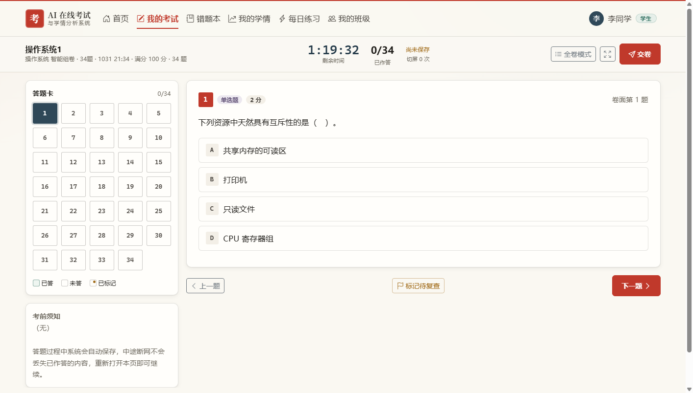
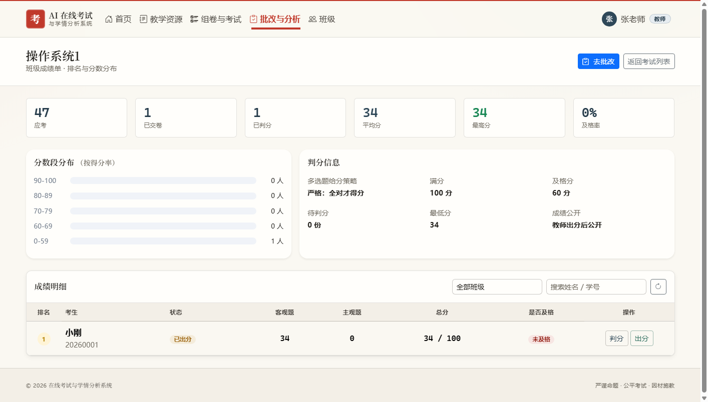

# 基于 Django 的 AI 在线考试与学情分析系统

> 集**教师出题、智能组卷、在线考试、AI 自动批改、学情分析与个性化推荐**于一体的在线考试平台。
> AI 的加入让系统从传统的「答题工具」升级为「智慧教学助手」。

<p align="center">
  
  
</p>

<p align="center">
  <sub>左：学生答题页（答题卡 / 倒计时 / 自动暂存）　·　右：教师成绩看板（分数段分布 / 成绩明细）</sub>
</p>

## 关于这个项目

这是一个**自研的完整业务系统**（11 个模块 / 124 个 REST 接口 / 246 条功能用例），
同时作为**软件测试实践对象**——配套的功能、接口、UI、性能四层测试工程独立维护，
在 4 轮测试中累计发现并推动修复 4 个缺陷（含 1 个答案泄漏的严重缺陷）。

## 文档导航

| 文档 | 内容 |
|---|---|
| [`docs/进度记录.md`](docs/进度记录.md) | **先读这个**：做到哪了、下一步做什么、怎么跑起来 |
| [`docs/需求规格说明书.md`](docs/需求规格说明书.md) | 系统「要什么」：角色权限、FR 需求编号、非功能需求、需求 ↔ 实现对照矩阵 |
| [`docs/接口文档.md`](docs/接口文档.md) | **124 个** REST 接口操作：路径 / 权限 / 参数 / 响应 / 错误码 |
| [`docs/开发文档.md`](docs/开发文档.md) | 架构、目录、环境搭建、11 个模块设计、关键决策、AI 接入、部署、扩展指引 |
| [`docs/数据库设计文档.md`](docs/数据库设计文档.md) | 15 张表的字段、索引、关系、数据量与保留策略 |
| [`docs/测试用例.md`](docs/测试用例.md) | **246 条功能用例全文**：设计说明 + 条数统计 + 逐条八大要素（编号对应 FR） |
| `功能测试报告.md`（见交付目录 `（配套测试项目）`） | 功能测试执行报告（246 条用例 / 7 个缺陷闭环 / 上线结论） |
| `需求分析与测试点.xmind`（见交付目录 `（配套测试项目）`） | 测试点清单导图：13 个分支 × 正向 121 / 反向 202 |
| `OnlineExam-功能测试用例.xlsx`（见交付目录） | 用例执行工作簿 v1.8：执行结果 / 缺陷与观察项 / 覆盖矩阵 |
| [`docs/开发路线图.md`](docs/开发路线图.md) | 十一个模块的规划与落地要点 |

---

## 一、技术栈

| 层次 | 选型 | 说明 |
|---|---|---|
| 后端框架 | Django 4.2 LTS | 稳定、生态成熟 |
| API 层 | Django REST Framework 3.16 | 序列化器 / ViewSet / 权限 / 分页 |
| 认证 | SimpleJWT 5.5 | 无状态 JWT，支持 refresh 轮换与黑名单登出 |
| 接口文档 | drf-spectacular | 自动生成 OpenAPI 3 + Swagger UI |
| 前端 | Django 模板 + Bootstrap 5.3 | 服务端渲染，开箱即用；浏览器端再按需挂 Vue |
| 可视化 | ECharts 5.5 | 雷达图 / 直方图 / 折线图（模块 3 起用于组卷质量看板） |
| 数据库 | MySQL 5.6（当前）/ SQLite | `.env` 一行切换 `DB_ENGINE` |
| 大模型 | DeepSeek（默认）/ 豆包 / 腾讯元宝 / OpenAI | 统一适配层，`.env` 切换 provider；**未配 Key 自动走本地模拟** |

---

## 二、快速开始

```bash
# 1) 创建并激活虚拟环境（Windows）
cd OnlineExam
.venv\Scripts\activate

# 2) 安装依赖
pip install -r requirements.txt

# 3) 配置环境变量
copy .env.example .env        # 然后按需修改（数据库、AI Key）

# 4) 建表 + 初始化演示数据
python manage.py migrate
python manage.py seed_users        # 演示账号
python manage.py seed_questions    # 20 个知识点 + 19 道样题
python manage.py seed_papers       # 3 份演示试卷（AI 智能组卷 + 组卷说明）
python manage.py seed_exams        # 3 场演示考试（进行中 / 待开始 / 已结束）
python manage.py seed_subjects     # 3 学科教师（操作系统/计算机网络/组成原理）+ 各自题库 + 3 班级×10 学生

# 5) 启动
python manage.py runserver
```

> **PyCharm 用户必看（最常见的一个坑）**
> 依赖装在项目的 `.venv` 里：**Python 3.13 + Django 4.2.30 + DRF 3.16.1 + drf-spectacular**。
> 若 PyCharm 用的还是系统 Python（`python`，只有 Django 3.2、**没有 DRF**），
> 就会在 `OnlineExam/urls.py` 第 15 行 `from drf_spectacular.views import ...` 报导入错误
> ——这不是版本不兼容，是**解释器选错了**。
>
> 两种解法，任选其一：
> 1. `Settings → Python Interpreter → ⚙ → Add → Virtualenv Environment → Existing`，
>    选 **`.venv\Scripts\python.exe`**；
> 2. 不配 IDE，直接双击 **`scripts\run_dev.bat`**（用项目虚拟环境起 8000 端口）。
>
> 改了代码看不到效果时：确认终端用的是 `.venv`，并执行一次**硬刷新**（`Ctrl+F5`），
> 旧进程若用 `--noreload` 启动，模板/静态资源不会随改动更新。

启动后访问：

| 地址 | 说明 |
|---|---|
| http://127.0.0.1:8000/ | 首页（未登录看介绍，已登录进工作台） |
| http://127.0.0.1:8000/login/ | 登录页 |
| http://127.0.0.1:8000/register/ | 注册页 |
| http://127.0.0.1:8000/profile/ | 个人中心 |
| http://127.0.0.1:8000/question-bank/ | 题库管理（教师 / 管理员） |
| http://127.0.0.1:8000/question-bank/new/ | 新建题目（按题型动态渲染表单） |
| http://127.0.0.1:8000/question-bank/ai-generate/ | AI 智能出题工作台 |
| http://127.0.0.1:8000/knowledge-points/ | 知识点树管理 |
| http://127.0.0.1:8000/papers/ | 试卷列表（模块 3） |
| http://127.0.0.1:8000/papers/new/ | 组卷工作台（模块 3）· **支持 AI 组卷、随机组卷（按知识点，不调 AI）与纯手动组卷** |
| http://127.0.0.1:8000/exams/ | **考试管理（模块 4，教师）** |
| http://127.0.0.1:8000/exams/{id}/monitor/ | **考试监控看板（模块 4，教师）** |
| http://127.0.0.1:8000/my-exams/ | **我的考试（模块 4，学生）** |
| http://127.0.0.1:8000/exams/{id}/take/ | **答题页（模块 4，学生）** |
| http://127.0.0.1:8000/exams/{id}/result/ | **交卷结果（模块 4，学生）** |
| http://127.0.0.1:8000/grading/ | **批改工作台（模块 5，教师）** |
| http://127.0.0.1:8000/grading/exams/{id}/scoreboard/ | **班级成绩单（模块 5，教师）** |
| http://127.0.0.1:8000/my-wrong-book/ | **我的错题本（模块 5，学生）** |
| http://127.0.0.1:8000/analytics/ | **学情仪表盘（模块 6，教师）** |
| http://127.0.0.1:8000/analytics/students/{id}/ | **教师看单个学生学情（模块 6）** |
| http://127.0.0.1:8000/analytics/me/ | **我的学情（模块 6，学生）** |
| http://127.0.0.1:8000/practice/ | **每日练习（模块 7，学生）** |
| http://127.0.0.1:8000/proctoring/ | **作弊检测看板（模块 8，教师）** |
| http://127.0.0.1:8000/proctoring/attempts/{id}/evidence/ | **作答证据链（模块 8，教师）** |
| http://127.0.0.1:8000/classrooms/ | **班级列表（模块 9，教师管理 / 学生只读）** |
| http://127.0.0.1:8000/classrooms/{id}/ | **班级详情与成员管理（模块 9）** |
| http://127.0.0.1:8000/manage/ | **管理控制台（管理员）· 数据总览** |
| http://127.0.0.1:8000/manage/users/ | **用户管理（管理员）· 列表 / 筛选 / 重置密码 / 停用** |
| http://127.0.0.1:8000/manage/users/new/ | **新建用户（管理员）** |
| http://127.0.0.1:8000/manage/org/ | **组织与基础数据（管理员）** |
| http://127.0.0.1:8000/manage/system/ | **系统配置（管理员）· AI Provider / 系统信息 / 开发者工具** |
| http://127.0.0.1:8000/api/docs/ | Swagger 接口文档（可直接在线调试） |
| http://127.0.0.1:8000/api/health/ | 健康检查 |
| http://127.0.0.1:8000/admin/ | Django 后台 |

**演示账号**（密码统一 `Exam@123456`）：

| 用户名 | 角色 |
|---|---|
| `admin` | 管理员 |
| `teacher` | 教师 |
| `student` | 学生 |
| `os_teacher` | 教师（操作系统，只管理该学科） |
| `net_teacher` | 教师（计算机网络，只管理该学科） |
| `arch_teacher` | 教师（计算机组成原理，只管理该学科） |

> 登录支持 **用户名 / 邮箱 / 学号** 三种方式，任选其一即可。
> 后 3 个学科教师账号由 `python manage.py seed_subjects` 创建，登录后只能看到 / 管理
> 自己任教学科的题库、试卷与考试（管理员与未设学科的 `teacher` 不受限）。

---

## 三、运行测试

```bash
python manage.py test apps                  # 全量（1200 个用例，约 8~10 分钟）
python manage.py test apps.users -v 2       # 用户与认证
python manage.py test apps.ai -v 2          # AI 适配层
python manage.py test apps.questions -v 2   # 题库与知识点
python manage.py test apps.papers -v 2      # 试卷与组卷
python manage.py test apps.exam -v 2        # 在线考试
python manage.py test apps.grading -v 2     # 判分与成绩
python manage.py test apps.analytics -v 2   # 学情分析
python manage.py test apps.recommend -v 2   # 个性化推荐
python manage.py test apps.proctoring -v 2  # 作弊行为检测
python manage.py test apps.classroom -v 2   # 班级管理

# 前端质量
python scripts/check_inline_js.py       # 模板内联 JS **语法**检查（26 个脚本块，需 node）
python scripts/check_practice_js.py     # 页面内联 JS **逻辑**校验（真的执行一遍，23 项）

# 真机浏览器验证（可选，需 selenium + chromedriver；先起服务）
#   chromedriver 不入库（24 MB 且与平台相关），请自行下载对应版本：
#   https://googlechromelabs.github.io/chrome-for-testing/
#   解压后放到 scripts/drivers/chromedriver(.exe)
python scripts/browser_check_practice.py
```

> 为什么要三个层级：`node --check` 只能证明语法没错，DOM stub 只能证明函数逻辑对，
> 都**证明不了页面真的点得动**（曾经选择题被渲染成纯文本、主观题没有输入框，前两层照样全绿）。
> `browser_check_practice.py` 用真实浏览器打开「每日练习」，真的点一下选项、提交一次看批改。

还有一份**端到端冒烟测试**（真实 HTTP 请求，覆盖页面可达性、JWT 全链路、
AI 适配层、导入导出、试卷与组卷、在线考试、判分与成绩、学情分析、个性化推荐、
作弊行为检测、班级管理、权限边界），需要先起服务：

```bash
# 终端 1
python manage.py runserver 127.0.0.1:8777
# 终端 2
python scripts/smoke_test.py
```

还有一个**模板内联 JS 语法检查**：把页面渲染成真实 HTML，再把不含 `src` 的
`<script>` 块逐个交给 `node --check`——查的是浏览器实际会执行的代码：

```bash
set NODE_BIN=<node 可执行文件路径>
python scripts/check_inline_js.py
```

> 测试默认走 mock provider，**不依赖外网**，也不需要 API Key。
> （`settings/base.py` 在 `test` 子命令下会强制清空所有 provider 的 api_key。）

---

## 四、目录结构

```
OnlineExam/
├── .env / .env.example          # 环境变量（密钥、数据库、AI Key）
├── .venv/                       # 虚拟环境
├── manage.py
├── requirements.txt
├── README.md
├── docs/
│   ├── 开发路线图.md             # 全部模块规划（本次任务的"施工图"）
│   └── 进度记录.md               # 已完成 / 待办，支持跨会话续做
├── scripts/
│   ├── smoke_test.py            # 端到端冒烟测试（真实 HTTP）
│   └── check_inline_js.py       # 模板内联 JS 语法检查（渲染后交给 node --check）
├── OnlineExam/                  # 项目配置包
│   ├── settings/
│   │   ├── base.py              # 公共配置
│   │   ├── development.py       # 开发环境
│   │   └── production.py        # 生产环境
│   ├── urls.py                  # 总路由
│   ├── wsgi.py / asgi.py
├── apps/                        # 业务模块（一个域一个包）
│   ├── common/                  # 公共：统一响应 / 分页 / 权限 / 异常 / 页面 mixin
│   ├── users/                   # 模块一：用户与认证
│   │   ├── models.py            # 自定义 User（管理员/教师/学生）
│   │   ├── managers.py          # 自定义 QuerySet
│   │   ├── serializers.py       # DRF 序列化器
│   │   ├── views.py             # API 视图
│   │   ├── views_pages.py       # 页面视图
│   │   ├── services.py          # 业务服务层（事务）
│   │   ├── backends.py          # 用户名/邮箱/学号 登录后端
│   │   ├── urls.py / forms.py / admin.py / signals.py
│   │   └── tests/               # 测试
│   ├── ai/                      # 模块二之 A：大模型统一适配层
│   │   ├── providers/           # base / openai_compatible / mock（四平台统一）
│   │   ├── prompts/             # 提示词模板（.txt，集中管理）
│   │   ├── client.py            # AIClient：重试 / 记账 / 场景化调用
│   │   ├── schemas.py           # 结构化输出解析（模型输出当不可信输入）
│   │   ├── mocks.py             # 无 Key 时的本地模拟
│   │   ├── models.py            # AIRequestLog 调用日志
│   │   └── tests/               # 测试
│   └── questions/               # 模块二之 B：题库
│       ├── models.py            # KnowledgePoint / Question / QuestionOption
│       ├── serializers.py       # 含「学生视角」序列化器（不含答案）
│       ├── services.py          # 落库校验 + AI 出题/评分服务
│       ├── importers.py         # CSV / XLSX 导入导出
│       ├── filters.py / views.py / views_pages.py / urls.py
│       └── tests/               # 测试
│   └── papers/                  # 模块三：试卷与组卷
│       ├── models.py            # Paper / PaperSection / PaperQuestion（三层）
│       ├── services.py          # PaperService（编排）+ PaperAnalysisService（质量分析）
│       ├── composer.py          # PaperComposeService：智能组卷算法
│       ├── ai_services.py       # PaperAIService：组卷说明
│       ├── exporters.py         # 导出 HTML（可打印）/ Markdown
│       ├── serializers.py       # 含「学生视角」卷内题目序列化器
│       ├── filters.py / views.py / views_pages.py / urls.py / constants.py
│       └── tests/               # 测试
│   └── exam/                    # 模块四：在线考试
│       ├── models.py            # Exam / ExamAttempt / Answer
│       ├── services.py          # ExamService（考务）+ ExamAttemptService（作答全流程）
│       │                        #   + ExamAnalysisService（看板统计）
│       ├── serializers.py       # 教师视角 / 学生视角分层（学生视角不含试卷内容）
│       ├── filters.py / views.py / views_pages.py / urls.py / constants.py
│       ├── management/commands/seed_exams.py
│       └── tests/               # 测试（服务层 60 + 接口 48）
│   ├── grading/                 # 模块五：判分与成绩
│       ├── models.py            # GradingFeedback（教师复核审计表，唯一的「新表」）
│       ├── services.py          # ObjectiveGradingService（纯函数判客观）
│       │                        #   + SubjectiveGradingService（AI 批主观）
│       │                        #   + GradingService（汇总唯一写入口 + 状态机）
│       │                        #   + ScoreReportService（成绩单 / 错题本 / 校准）
│       ├── serializers.py       # 判分 / 复核入参校验
│       ├── views.py / views_pages.py / urls.py / constants.py
│       └── tests/               # 测试（客观 28 / 主观 16 / 流程 20 / 复核 22 / 报告 17 / 接口 41）
│   ├── analytics/               # 模块六：学情分析
│       ├── models.py            # StudentAnalysisReport（AI 诊断缓存，唯一新表）
│       ├── services.py          # KnowledgeMasteryService（掌握度 + 向上归并）
│       │                        #   + TrendService（线性回归趋势）
│       │                        #   + ClassAnalysisService（分布 / 逐题 / 区分度）
│       │                        #   + AIAnalysisService（AI 诊断 + 降级 + 缓存）
│       │                        #   + AnalyticsReportService（页面聚合入口）
│       ├── serializers.py       # 查询参数 / 诊断入参校验
│       ├── views.py / views_pages.py / urls.py / constants.py
│       └── tests/               # 测试（掌握度 13 / 趋势 13 / 班级 10 / AI 19 / 接口 19）
│   ├── recommend/               # 模块七：个性化推荐（**不建表**，纯只读模型）
│       ├── services.py          # ContentBasedService（薄弱度 × 难度适配度）
│       │                        #   + CollaborativeFilteringService（item-based 余弦）
│       │                        #   + RecommendationService（每日成集 + 理由 + AI 改写）
│       ├── serializers.py       # 每日练习查询参数 / AI 理由入参校验
│       ├── views.py / views_pages.py / urls.py / constants.py
│       └── tests/               # 测试（内容 15 / 协同 18 / 成集 24 / AI 理由 8 / 接口 19）
│   └── proctoring/              # 模块八：作弊行为检测
│       ├── models.py            # ExamBehaviorLog（逐条行为埋点，唯一新表；只存事实不存结论）
│       ├── services.py          # BehaviorLogService（埋点写入 + 保留策略）
│       │                        #   + RuleEngineService（可解释规则引擎）
│       │                        #   + AnomalyDetectionService（孤立森林 + 降级）
│       │                        #   + ProctoringReportService（名单 + 证据链聚合）
│       ├── serializers.py       # 报告查询参数 / 行为上报字段说明
│       ├── views.py / views_pages.py / urls.py / constants.py / admin.py
│       ├── management/commands/purge_behavior_logs.py
│       └── tests/               # 测试（埋点 18 / 规则 25 / 异常 18 / 接口 23）
│   └── classroom/               # 模块九：班级管理
│       ├── models.py            # Classroom（班级实体 + 学生/教师多对多，唯一新表）
│       ├── services.py          # ClassroomService（建班 / 成员增删 / 学号导入 / 归档）
│       ├── serializers.py / views.py / views_pages.py / urls.py / admin.py / constants.py
│       └── tests/               # 测试（服务层 13 / 接口 11）
│   └── system/                  # 模块十：管理端（**无 models，零迁移**）
│       ├── services.py          # SystemOverviewService（全部在 SQL 层聚合，无 N+1）
│       ├── views.py / urls.py   # GET /api/v1/system/overview/
│       ├── views_pages.py / urls_pages.py  # /manage/ 四页（总览 / 用户 / 组织 / 配置）
│       └── tests/
├── templates/                   # 模板
│   ├── papers/                  # 试卷列表 + 三栏组卷工作台
│   ├── exam/                    # 考试列表 / 监控看板 / 我的考试 / 答题页 / 结果
│   ├── grading/                 # 批改工作台 / 班级成绩单 / 错题本
│   ├── analytics/               # 学情仪表盘 / 学生学情（我的学情）
│   ├── recommend/               # 每日练习
│   ├── proctoring/              # 作弊检测看板 / 作答证据链
│   └── classroom/               # 班级列表 / 班级详情与成员管理
├── static/                      # 静态资源
└── media/                       # 用户上传（头像）
```

---

## 五、统一接口约定

所有接口返回同一种形状，前端只需写一次解析逻辑：

```json
{
  "code": 0,
  "message": "success",
  "data": { }
}
```

| code | 含义 |
|---|---|
| `0` | 成功 |
| `40000` / `40100` / `40300` / `40400` | 客户端错误，等于 HTTP 状态码 × 100 |
| `50000` | 服务端错误 |
| `10001` ~ `19999` | 业务语义错误（如 `10001` 用户名已被占用） |

分页响应统一为 `data.count / total_pages / page / page_size / next / previous / results`。

### 已实现的接口

**模块 1 · 用户与认证**

| 方法 | 路径 | 说明 | 权限 |
|---|---|---|---|
| POST | `/api/v1/auth/register/` | 注册（仅学生 / 教师） | 公开 |
| POST | `/api/v1/auth/login/` | 登录，返回 access + refresh + user | 公开 |
| POST | `/api/v1/auth/refresh/` | 刷新 access | 公开 |
| POST | `/api/v1/auth/logout/` | 登出（refresh 拉黑） | 登录 |
| GET | `/api/v1/auth/me/` | 当前用户信息 | 登录 |
| PATCH | `/api/v1/auth/me/` | 修改自己的资料 | 登录 |
| POST | `/api/v1/auth/change-password/` | 修改密码 | 登录 |
| GET/POST | `/api/v1/users/` | 用户列表 / 新建 | 管理员 |
| GET/PUT/PATCH/DELETE | `/api/v1/users/{id}/` | 用户详情 / 更新 / 删除 | 管理员 |
| GET | `/api/v1/users/teachers/` | 教师列表 | 管理员 |
| GET | `/api/v1/users/students/` | 学生列表 | 管理员 |
| POST | `/api/v1/users/{id}/reset-password/` | 重置密码 | 管理员 |
| POST | `/api/v1/users/{id}/toggle-active/` | 启用 / 停用 | 管理员 |
| GET | `/api/health/` | 健康检查 | 公开 |

**模块 2 · AI 能力**（教师 / 管理员）

| 方法 | 路径 | 说明 |
|---|---|---|
| POST | `/api/v1/ai/chat/` | 在线调试大模型（支持 `prompt` / `messages` / 场景 + `variables` 三种入参） |
| POST | `/api/v1/ai/test-connection/` | 测试当前平台连通性 |
| GET | `/api/v1/ai/providers/` | 平台清单与配置状态（含当前 provider、是否 mock） |
| GET | `/api/v1/ai/usage/` | 调用用量统计（按场景 / 成功率 / tokens / 平均耗时） |
| GET | `/api/v1/ai/logs/` | 最近调用记录 |

**模块 2 · 题库**

| 方法 | 路径 | 说明 |
|---|---|---|
| GET/POST | `/api/v1/knowledge-points/` | 知识点列表 / 新建 |
| GET | `/api/v1/knowledge-points/tree/` | 知识点树（一次拿全） |
| GET/PUT/PATCH/DELETE | `/api/v1/knowledge-points/{id}/` | 知识点详情 / 更新 / 删除 |
| GET | `/api/v1/knowledge-points/{id}/questions/` | 该知识点（含子知识点）下的题目 |
| GET/POST | `/api/v1/questions/` | 题目列表（多条件筛选）/ 新建 |
| GET/PUT/PATCH/DELETE | `/api/v1/questions/{id}/` | 题目详情 / 更新 / **停用（软删除）** |
| POST | `/api/v1/questions/ai-generate/` | **AI 辅助出题**（返回草稿，不落库） |
| POST | `/api/v1/questions/batch/` | 批量入库（确认 AI 草稿 / 导入结果） |
| POST | `/api/v1/questions/{id}/ai-explain/` | 让 AI 补写 / 重写解析 |
| POST | `/api/v1/questions/{id}/ai-grade/` | 主观题 AI 试评 |
| POST | `/api/v1/questions/import/` | 批量导入（`.xlsx` / `.csv`，支持 `dry_run` 预检） |
| GET | `/api/v1/questions/export/` | 导出（`?file_format=csv` 或 `xlsx`，默认 xlsx） |
| GET | `/api/v1/questions/import-template/` | 下载导入模板（带 UTF-8 BOM，Excel 打开不乱码） |
| GET | `/api/v1/questions/statistics/` | 题库统计（题型 / 难度 / 来源 / 知识点分布 + 平均难度系数） |

> 题库相关接口**全部要求教师或管理员**——学生不直接接触题库，从根上避免答案泄漏。
> 考试模块下发试卷时用的是 `QuestionStudentSerializer`，它的字段里根本没有
> `reference_answer` / `analysis` / `options[].is_correct`。

**筛选参数示例**：

```
/api/v1/questions/?type=single&difficulty=2&subject=数据结构&keyword=栈
/api/v1/questions/?knowledge_point=3         # 含该知识点的所有子知识点
/api/v1/questions/?has_ai=true&is_active=true
/api/v1/questions/?page=2&page_size=20
```

**模块 3 · 试卷与组卷**

| 方法 | 路径 | 说明 |
|---|---|---|
| GET/POST | `/api/v1/papers/` | 试卷列表（状态 / 学科 / 组卷方式 / 分值区间筛选）/ 新建 |
| GET/PUT/PATCH/DELETE | `/api/v1/papers/{id}/` | 详情（卷头 + 大题 + 全部题目，**含答案**）/ 更新 / 删除 |
| POST | `/api/v1/papers/{id}/questions/` | 往卷里加题（`strict=false` 时静默跳过重复题） |
| POST | `/api/v1/papers/{id}/remove-questions/` | 把题移出试卷（传 `PaperQuestion.id`） |
| POST | `/api/v1/papers/{id}/scores/` | 批量调分 |
| POST | `/api/v1/papers/{id}/reorder/` | 调整题序 |
| POST | `/api/v1/papers/{id}/clone/` | 复制试卷（做 A/B 卷） |
| POST | `/api/v1/papers/{id}/status/` | 发布 / 退回草稿 / 归档 |
| GET | `/api/v1/papers/{id}/preview/` | 卷面预览（按大题分组，含大题说明与每题分值） |
| GET | `/api/v1/papers/{id}/analysis/` | **组卷质量分析**（ECharts 数据 + 六类预警） |
| POST | `/api/v1/papers/{id}/ai-notes/` | 生成 / 重写 AI 组卷说明 |
| GET | `/api/v1/papers/{id}/export/` | 导出卷面（`?file_format=html\|md`，`?with_answer=true` 附答案页） |
| POST | `/api/v1/papers/ai-compose/` | **智能组卷**（`dry_run=true` 只试算不落库） |
| GET | `/api/v1/papers/pool/` | 题库家底（题型 × 难度库存矩阵） |
| GET | `/api/v1/papers/statistics/` | 试卷统计总览 |

> 试卷接口同样**全部要求教师或管理员**。学生只在模块 4 考试下发时拿到题目，
> 走的是 `PaperQuestionStudentSerializer` → `PaperQuestion.student_payload()`，
> 答案过滤逻辑**只有一处**（`Question.student_view()`），不会因为多一条下发路径就多一个泄漏点。

**智能组卷入参示例**：

```jsonc
POST /api/v1/papers/ai-compose/
{
  "title": "期中测试卷",
  "subject": "数据结构",
  "knowledge_point_ids": [3, 7],          // 不传 = 全题库范围；自动包含子知识点
  "target_difficulty": 2.0,               // 1 简单 → 4 挑战
  "duration_minutes": 90,
  "blueprint": [                          // 不传 = 用默认蓝图（100 分）
    {"type": "single", "count": 10, "score": 2},
    {"type": "short",  "count": 3,  "score": 10}
  ],
  "seed": 2026,                           // 传相同值可复现同一份卷子
  "dry_run": true,                        // 只试算
  "generate_notes": false                 // 是否调 AI 写组卷说明
}
```

**模块 4 · 在线考试**

| 方法 | 路径 | 说明 | 权限 |
|---|---|---|---|
| GET | `/api/v1/exams/` | 考试列表（教师看全部；**学生 = 我的考试**，不含任何试卷内容） | 登录 |
| POST | `/api/v1/exams/` | 新建考试 | 教师 |
| GET/PUT/PATCH/DELETE | `/api/v1/exams/{id}/` | 详情 / 修改 / 删除（已有人作答只能归档） | 教师 |
| POST | `/api/v1/exams/{id}/status/` | 发布 / 开始 / 结束 / 归档 | 教师 |
| GET | `/api/v1/exams/{id}/overview/` | 单场统计（应考 / 进行中 / 已交 / 超时 / 行为预警） | 教师 |
| GET | `/api/v1/exams/{id}/attempts/` | 作答明细看板（支持 `status` / `keyword`） | 教师 |
| GET | `/api/v1/exams/statistics/` | 全部考试总览 | 教师 |
| GET | `/api/v1/exams/candidates/` | 可选学生名单（建考试时选人） | 教师 |
| POST | `/api/v1/exams/{id}/start/` | **开始 / 继续作答**，下发试卷（**剔除答案**） | 学生 |
| GET | `/api/v1/attempts/` | 作答列表（学生=自己的；教师=全部） | 登录 |
| GET | `/api/v1/attempts/{id}/` | 作答概要 | 本人 / 教师 |
| GET | `/api/v1/attempts/{id}/paper/` | **卷面 + 已存答案**（刷新 / 断网续考恢复） | 本人 |
| GET/POST | `/api/v1/attempts/{id}/answers/` | 逐题明细（教师批改）/ 批量暂存 | 教师 / 本人 |
| POST | `/api/v1/attempts/{id}/save/` | 单题暂存 | 本人 |
| POST | `/api/v1/attempts/{id}/heartbeat/` | 心跳，返回**服务端权威剩余时间** | 本人 |
| POST | `/api/v1/attempts/{id}/behavior/` | 行为上报（切屏 / 粘贴 / 退出全屏） | 本人 |
| POST | `/api/v1/attempts/{id}/submit/` | 交卷（可带最后一批作答一起落盘） | 本人 |
| GET | `/api/v1/attempts/{id}/result/` | 结果（判分且允许公示时才给分数与逐题得分） | 本人 / 教师 |

> **模块 4 的两条纪律**（写新代码时不要绕开）：
> 1. **服务端是唯一计时权威**——`deadline_at` 在开考那刻算好落库，
>    前端倒计时只负责显示；心跳里上报的客户端剩余时间只作为「时钟漂移」观测值记录。
> 2. **答案过滤只有一个出口**——下发走 `ExamAttemptService._question_payload()`，
>    它只转出 `PaperQuestion.student_payload()` 的白名单字段。加下发路径 = 多一个泄漏点。

**开考试入参示例**：

```jsonc
POST /api/v1/exams/
{
  "title": "数据结构期中考试",
  "paper_id": 13,                     // 必须是「已发布」的试卷
  "start_time": "2026-10-08 09:00",   // 留空 = 发布后立即可考
  "end_time":   "2026-10-08 11:00",   // 留空 = 不限结束时间
  "duration_minutes": 90,             // 0 = 沿用试卷时长
  "max_attempts": 1,
  "shuffle_questions": true,          // 题序乱序（每人固定种子，刷新不变）
  "shuffle_options": true,
  "detect_switch": true,
  "max_switch_count": 3,              // 超过 3 次记违规
  "auto_submit_on_limit": false,      // true = 超限立即强制交卷
  "detect_paste": true,
  "fullscreen_required": false,
  "allow_resume": true,               // 断网续考
  "open_to_all": false,               // false 时按 participant_ids 指定考生
  "participant_ids": [3, 4, 5],
  "multiple_choice_policy": "strict"  // 多选题判分策略：strict / partial / penalty
}
```

**模块 5 · 判分与成绩**

| 方法 | 路径 | 说明 | 权限 |
|---|---|---|---|
| POST | `/api/v1/grading/attempts/{id}/grade/` | 判分（默认只判客观题；`{"with_ai": true}` 才批主观题） | 教师 |
| POST | `/api/v1/grading/attempts/{id}/finalize/` | **出分**，学生从此可见成绩 | 教师 |
| POST | `/api/v1/grading/answers/{id}/review/` | 复核一道题（改分 + 评语 / `{"accept_ai": true}` 一键采纳） | 教师 |
| GET | `/api/v1/grading/queue/` | 待批改队列（`exam_id` 过滤，`only_pending` 默认 true） | 教师 |
| GET | `/api/v1/grading/exams/` | 可批改的考试列表（工作台选择器） | 教师 |
| GET | `/api/v1/grading/attempts/{id}/report/` | 成绩单（教师全量 / 学生按公开规则脱敏） | 本人 / 教师 |
| GET | `/api/v1/grading/feedback/` | 复核记录（可按 `attempt_id` / `answer_id` 过滤） | 教师 |
| GET | `/api/v1/grading/scoreboard/` | 班级成绩单（排名 / 分数段 / 及格率） | 教师 |
| GET | `/api/v1/grading/wrong-book/` | 错题本（学生看自己；教师需指定 `student_id`） | 登录 |
| GET | `/api/v1/grading/calibration/` | AI 批改校准统计（采纳率 / 平均偏差 / 分档一致率） | 教师 |

> **模块 5 的三条纪律**（写新代码时不要绕开）：
> 1. **汇总只有一个写入口** —— `GradingService.recalc()` 每次都从 `Answer` **重算**
>    （而不是 `score += x`），这是幂等的来源；任何地方都不要自己拼总分。
> 2. **状态要跟着分数走** —— 有分数写入就把 `ExamAttempt.status` 从 `submitted`
>    推到 `auto_graded` / `reviewing` / `graded`，否则学生端永远看不到成绩。
> 3. **AI 输出当不可信输入** —— 主观题批改失败一律降级为「待人工判分」，
>    绝不把异常抛给教师，也绝不把 0 分当「AI 判的结论」写进库。

**模块 6 · 学情分析**

| 方法 | 路径 | 说明 | 权限 |
|---|---|---|---|
| GET | `/api/v1/analytics/exams/` | 可分析的考试列表（有作答记录的） | 教师 |
| GET | `/api/v1/analytics/exams/{id}/report/` | 班级学情总览（分布 / 参与度 / 薄弱点 / 排名，`include_rows` 带逐人明细） | 教师 |
| GET | `/api/v1/analytics/exams/{id}/questions/` | 逐题得分率与区分度 | 教师 |
| GET | `/api/v1/analytics/students/{id}/mastery/` | 知识点掌握度矩阵（含雷达数据与薄弱点） | 本人 / 教师 |
| GET | `/api/v1/analytics/students/{id}/trend/` | 成绩趋势（含线性回归预测，`limit` 控制点数） | 本人 / 教师 |
| GET | `/api/v1/analytics/students/{id}/report/` | 个人学情总览（雷达 / 趋势 / 薄弱点 / 已有诊断；**不调大模型**） | 本人 / 教师 |
| POST | `/api/v1/analytics/students/{id}/diagnosis/` | 生成 / 刷新 AI 学情诊断（`subject` / `force` / `provider`；24h 内命中缓存） | 本人 / 教师 |

> **模块 6 的三条纪律**（写新代码时不要绕开）：
> 1. **只读判分结果，绝不重算分** —— 掌握度读的是模块五判好的
>    `Answer.is_correct` / `Answer.score`；自己再判一次，两套口径迟早打架。
> 2. **聚合进服务层，视图只做参数校验与序列化** —— 所有统计口径留在
>    `apps/analytics/services.py`，避免两个页面把同一个指标算出两个数。
> 3. **图表数据一律给「前端可直接喂 ECharts」的结构** —— 雷达 `{indicator, values}`、
>    分布 `{buckets, stats, normal}`、趋势 `{points, fit}`，前端只渲染不聚合。
>
> 另：**「薄弱」是有统计门槛的结论**（`MIN_SAMPLES_FOR_WEAKNESS=2`），
> 只做过 1 题且答错只算「数据不足」；**GET 不调大模型**，AI 诊断是花钱的动作，
> 只由 `POST .../diagnosis/` 触发。

**模块 7 · 个性化推荐**

| 方法 | 路径 | 说明 | 权限 |
|---|---|---|---|
| GET | `/api/v1/recommend/students/{id}/practice/` | 每日练习推荐（本地理由，**不调大模型**；`subject` / `size` / `offset`） | 本人 / 教师 |
| POST | `/api/v1/recommend/students/{id}/practice/` | 同一份推荐，理由交给大模型改写（`provider`；失败降级；24h 内命缓存） | 本人 / 教师 |

**页面 `/practice/`（每日练习）可在页面内直接作答：**

| 题型 | 作答方式 | 批改方式 |
|---|---|---|
| 单选 / 判断 | 点选（单选互斥） | 本地即时判对错 |
| 多选 | 多选（可同时选中多个） | 忽略选项顺序，**漏选 / 多选都判错** |
| 填空 | 文本框，**每个空写一行** | 逐空比对，忽略大小写与空白、标点差异 |
| 简答 / 论述 | 多行文本框 | **不假装机器判**，提交后对照参考答案自评 |

先提交作答才能查看答案与解析（避免直接偷看）；已判过的卡片会锁定，可点「再做一次」重来。
练习是**本地即时批改**，不在服务端落任何记录，**不计入考试成绩、也不改变学情数据**。

> **模块 7 的三条纪律**（写新代码时不要绕开）：
> 1. **只读判分结果与掌握度，绝不重算** —— 推荐读的是模块五判好的
>    `Answer.is_correct` / `Answer.score` 与模块六的 `student_mastery()`；
>    自己再算一遍掌握度，两套口径很快会打架。
> 2. **样本不足不给结论** —— 沿用 `MIN_SAMPLES_FOR_WEAKNESS`，
>    知识点只做过 1 题时不推「薄弱」、也不给练习，宁缺毋滥。
> 3. **协同过滤是「乘数加成」而非加权平均** —— `match = 内容分 × (1 + 0.30 × 协同分)`；
>    冷启动（`cf_scores={}`）时自动退化为纯内容分，匹配度依然可比、排序不会崩。
>
> 另：**推荐清单是「同一学生 + 同一天」的确定性函数**（`md5(student_id|date|question_id)` 打散），
> 刷新页面不换题、跨天自然轮换，因此**不建表、不写缓存**；
> **GET 绝不调大模型**，AI 只负责把理由改写成一句人话（选题仍由本地算法决定）。

**模块 8 · 作弊行为检测**

| 方法 | 路径 | 说明 | 权限 |
|---|---|---|---|
| GET | `/api/v1/proctoring/exams/` | 有行为埋点的考试列表（页面选择器） | 教师 |
| GET | `/api/v1/proctoring/exams/{id}/report/` | 可疑考生列表 + 概览 + 孤立森林异常检测（`only_suspicious` / `top_n`） | 教师 |
| GET | `/api/v1/proctoring/attempts/{id}/evidence/` | 逐条证据链（埋点时间线 + 命中规则 + 异常分 + 计数核对） | 教师 |
| GET | `/api/v1/proctoring/rules/` | 规则目录与阈值说明（「为什么可疑」的依据） | 教师 |

> **模块 8 的三条纪律**（写新代码时不要绕开）：
> 1. **只读不重算** —— 埋点缺失时用 `ExamAttempt` 的聚合计数**兜底**（取 `max`），
>    绝不反过来改写考试模块的计数；埋点入口复用模块四的
>    `ExamAttemptService.record_behavior()`（惰性 import + 失败不阻断考试链路）。
> 2. **结论必须可解释** —— 每条可疑信号都带 `code / name / reason / evidence`，
>    教师点开红色标记一定能看到「因为什么」；判定读时现算（阈值可配），
>    改阈值后历史结论不会过时。
> 3. **样本不足不给结论** —— 一场考试少于 `ANOMALY_MIN_SAMPLES(8)` 份作答时
>    不训练孤立森林，老实说「不够判」。
>
> 另：**`ExamBehaviorLog` 只存事实、不存结论**（切屏几次是事实，「算不算可疑」依赖阈值）；
> 异常检测未安装 `scikit-learn` 时自动降级为纯 Python 稳健 z-score（功能不中断，`method` 如实告知）；
> 埋点是写多读少的数据，用 `python manage.py purge_behavior_logs` 按保留期裁剪。

**模块 9 · 班级管理**

| 方法 | 路径 | 说明 | 权限 |
|---|---|---|---|
| GET | `/api/v1/classrooms/` | 班级列表（`keyword` / `class_type=admin\|subject` / `include_inactive`） | 登录（按角色可见范围） |
| POST | `/api/v1/classrooms/` | 建班（`name` 必填；`class_type` 行政班/学科班；学科班可传 `admin_class_id` 挂靠行政班） | 教师 / 管理员 |
| GET | `/api/v1/classrooms/options/` | 班级下拉（供成绩单 / 学情页按班筛选） | 教师 |
| GET | `/api/v1/classrooms/{id}/` | 班级详情 | 登录（可见范围） |
| PUT/PATCH | `/api/v1/classrooms/{id}/` | 全量 / 局部更新 | 教师（可管理）/ 管理员 |
| DELETE | `/api/v1/classrooms/{id}/` | **删除班级**（物理删除，成员关系一并清理） | 教师（可管理）/ 管理员 |
| GET | `/api/v1/classrooms/{id}/students/` | 成员列表 | 登录（可见范围） |
| POST | `/api/v1/classrooms/{id}/students/` | 添加学生（按 `student_ids` 或 `student_nos` 学号批量） | 教师（可管理）/ 管理员 |
| DELETE | `/api/v1/classrooms/{id}/students/` | 移出学生 | 教师（可管理）/ 管理员 |

**题库按科目分类**：`GET /api/v1/questions/subjects/` 返回当前教师可见范围内的
`[{subject, label, count}]`，题库页顶部的「科目」下拉即由此驱动（学科教师只拿到自己那一项）。

**联动**：模块 5 的 `GET /grading/scoreboard/` 与模块 6 的
`GET /analytics/exams/{id}/report/`、`GET /analytics/exams/{id}/questions/` 都新增
`classroom_id` 查询参数，传了只统计该班学生（成绩单 / 学情页顶部有班级下拉）。

> **模块 9 的三条纪律**（写新代码时不要绕开）：
> 1. **班级是系统里第一个真正的「班级」实体** —— 此前「班级成绩单」「班级维度」都是
>    「某场考试全部考生」的临时聚合；学生与班级的多对多关系落到 `Classroom.students`，
>    成绩单 / 学情再按 `classroom_id` 过滤，口径只留在服务端（`visible_to` / `manageable_by`）。
>    班级分**行政班**（学籍班）与**学科班**（按课程分的教学班），学科班可通过
>    `admin_class` 挂靠一个行政班；**学科班不设班主任**——学科老师通过「授课教师名单」归属。
> 2. **权限走「可见 / 可管理」两档** —— 学生只能看自己所在班；教师可管理「自己教的班」
>    （自己创建 / 任班主任 / **在该班授课名单里**），但**全部行政班对所有教师可见**
>    （建学科班时要能选到它挂靠）；管理员全部。无权访问一律 **404**
>    （不拿 403 当「是否存在」的探针）。
> 3. **删除是物理删除** —— 班级与考试 / 成绩之间没有外键，删掉不会破坏历史成绩的可追溯性；
>    若要「下线但保留」，用 `PATCH {is_active: false}` 归档。

**模块 10 · 管理端（系统管理）**

| 方法 | 路径 | 说明 | 权限 |
|---|---|---|---|
| GET | `/api/v1/system/overview/` | 系统级数据总览（用户结构 / 教学资源 / 考试作答 / AI 用量近 7 日） | 管理员 |
| GET | `/api/v1/users/` | 用户列表（`search` / `role` / `is_active` / `subject` / 分页） | 管理员 |
| POST | `/api/v1/users/` | 新建用户（密码走 `AUTH_PASSWORD_VALIDATORS`） | 管理员 |
| GET/PUT/PATCH | `/api/v1/users/{id}/` | 用户详情 / 更新（用户名创建后只读） | 管理员 |
| POST | `/api/v1/users/{id}/reset-password/` | 重置密码（不传则生成随机强密码；明文只出现在 `data.password`） | 管理员 |
| POST | `/api/v1/users/{id}/toggle-active/` | 启用 / 停用（停用即踢下线；最后一个启用管理员不可停用） | 管理员 |

**页面**：`/manage/`（数据总览）、`/manage/users/`（列表 + 筛选 + 分页）、
`/manage/users/new/`、`/manage/users/{id}/edit/`、`/manage/org/`（组织与基础数据）、
`/manage/system/`（AI Provider / 系统信息 / 开发者工具）。

> **模块 10 的三条纪律**（写新代码时不要绕开）：
> 1. **管理员默认进管理控制台，教学功能折叠为「代管」** —— 导航按角色分流，`admin` 分支必须
>    写在 `` **之前**（原先顺序写反，管理员直接看到教师那套菜单）。
>    管理员进入教师页面时顶部有常驻提示条；`IsTeacher` 接口层本期不收紧（方案 B+）。
> 2. **账号治理只停用、不物理删除** —— `ExamAttempt.student` 是 `CASCADE`、`created_by` 系列是
>    `SET_NULL`，删用户会连带删成绩或让历史资源失去归属；界面不提供删除，只停用。
>    重置密码必须过 `validate_password`，且**不再有固定兜底密码**（8 次随机生成全不合格就报错）。
> 3. **停用必须真正踢下线** —— Session 中间件对全站生效（停用账号回查 session 后 `logout()`），
>    JWT 侧在每次认证时校验 `is_active`。停用提示「该账号已被停用，请联系管理员」在
>    中间件 / 登录接口 / 登录页三处**逐字一致**；业务码 `40101` 表示账号停用、`40100` 表示通用认证失败。

> **首页与导航的分工（教师端 / 学生端二次设计）**：
> - **导航 = 功能地图（去哪里）**：教师端按领域分 4 组 —— 教学资源（题库 / AI 出题 / 知识点）、
>   组卷与考试、批改与分析、班级，不再 9 项平铺；
> - **首页 = 数据工作台（现在要做什么）**：教师看到「待批改 / 进行中考试 / 即将开始 / 我的班级」
>   四个数字 + 待办列表 + 最近考试；学生看到「待考 / 进行中 / 已考 / 我的班级」+ 继续答题 /
>   最近成绩 / 我的班级。**首页不再罗列功能入口卡片**（原先首页就是导航的卡片版，两处入口完全重复）；
> - 首页数据由 `HomeDashboardService` 服务端一次算完（单个请求），只做轻量 `count`/`limit`，
>   不在首页跑学情 / 推荐这类重计算；教师按任教学科隔离。

---

## 六、数据库

默认配置在 `.env` 里，当前跑的是**本机 MySQL 5.6.46**：

```ini
DB_ENGINE=mysql
DB_NAME=online_exam
DB_USER=root
DB_PASSWORD=你的密码
DB_HOST=127.0.0.1
DB_PORT=3306

# ⚠️ MySQL 5.6 专用
DB_CHARSET=utf8          # 5.6 的 InnoDB 单列索引上限 767 字节，utf8mb4 建表会失败
DB_SKIP_VERSION_CHECK=True   # Django 4.2 官方要求 MySQL 8.0.11+，5.6 需跳过校验
```

建库（**必须是 utf8 字符集**）：

```sql
CREATE DATABASE online_exam DEFAULT CHARACTER SET utf8 COLLATE utf8_general_ci;
```

想换回 SQLite 只需把 `DB_ENGINE` 改成 `sqlite`，无需改任何业务代码。

> **关于 MySQL 5.6 的说明**：MySQL 5.6 已于 2018 年停止维护，Django 4.2 官方要求 8.0.11+。
> 本项目做了兼容处理（跳过版本校验 + utf8 字符集），可以跑通，但不建议用于正式环境。
> 若升级到 MySQL 8.0，删掉上面两行兼容配置即可。

---

## 七、接入大模型

编辑 `.env`：

```ini
AI_PROVIDER=deepseek
DEEPSEEK_API_KEY=sk-xxxxxxxx
```

系统内置 `deepseek / doubao / yuanbao / openai` 四个 provider，都走 OpenAI 兼容协议，
改一行 `AI_PROVIDER` 即可切换。未配置 Key 时会自动降级为本地模拟回答，方便离线开发和课堂演示。

---

## 八、开发进度

详见 [`docs/进度记录.md`](docs/进度记录.md) 与 [`docs/开发路线图.md`](docs/开发路线图.md)。

- [x] 模块 0 · 项目骨架与配置
- [x] 模块 1 · 用户与认证
- [x] 模块 2 · AI 适配层 + 题库
- [x] 模块 3 · 试卷与组卷
- [x] 模块 4 · 在线考试
- [x] 模块 5 · 判分与成绩
- [x] 模块 6 · 学情分析
- [x] 模块 7 · 个性化推荐
- [x] 模块 8 · 作弊行为检测
- [x] 模块 9 · 班级管理
- [x] 模块 10 · 管理端（系统管理 / 用户治理）
- [x] 模块 11 · 系统测试与交付
