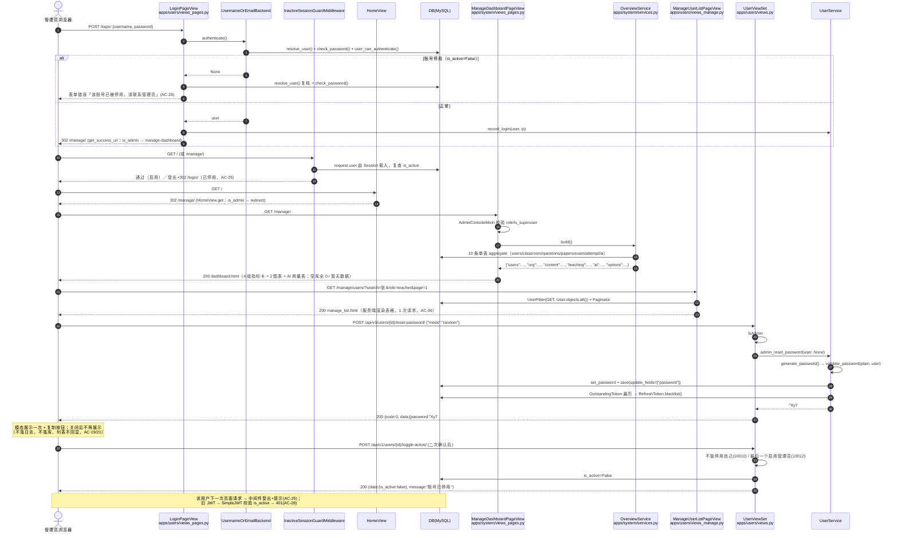
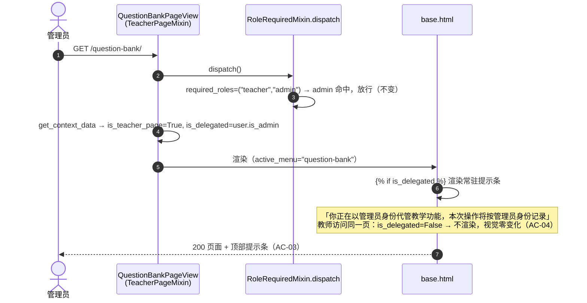
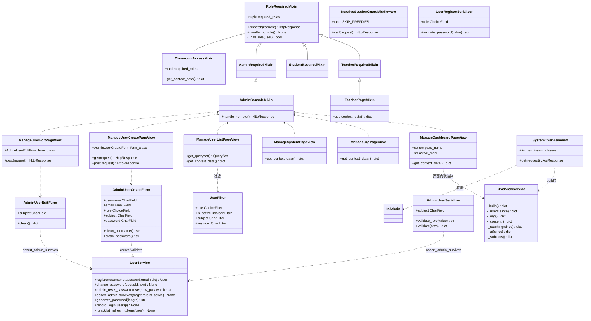
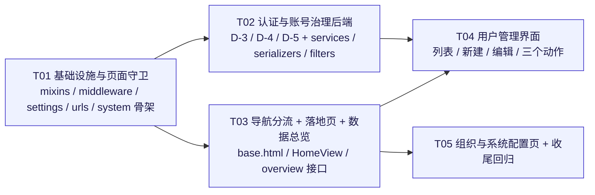

# 管理端增量设计（架构 + 任务分解）

> **文档性质**：增量设计文档，只覆盖本次管理端改造，不重写已完成模块的设计。
> **输入**：`docs/管理端增量PRD.md`（37 条 AC / 权限矩阵 / 信息架构 / 5 个缺陷 D-1~D-5）
> **已拍板决策**：Q-1=B+（界面分流 + 代管、接口不收紧）｜Q-2=只停用｜Q-3=注册仅学生｜Q-4=subject 自由文本 + 候选｜Q-5=不做强制首登改密
> **硬约束**：零数据库迁移（`makemigrations --check` 输出 No changes）｜既有 **781 个测试零改动通过**
> **本文结论全部基于对现有代码的实际阅读，标注文件路径与行号。**

---

## 0. 一页结论

| 维度 | 结论 |
|---|---|
| URL 方案 | `/manage/` 前缀（避开 Django 后台 `/admin/`），路由名 `manage-*`，只新增 1 个接口 `GET /api/v1/system/overview/` |
| 模板方案 | **复用同一套 `templates/base.html`**，导航按角色三分支（admin 分支**必须放最前**，修 D-1） |
| 渲染模式 | 用户列表/组织页**服务端渲染**（满足 AC-36 请求数 ≤2），行内危险动作走 JS 调既有 API |
| 新 app | **新建 `apps/system/`**（管理控制台 + 跨 6 个 app 的只读聚合），用户账号页留在 `apps/users/views_manage.py`（复用 UserFilter / AdminUserSerializer / UserService） |
| 守卫方案 | `RoleRequiredMixin` 增加 `handle_no_role()` 钩子（**默认仍抛 PermissionDenied**，保 proctoring 页面 403 测试）；新增 `AdminConsoleMixin` 实现「302 + messages」（AC-06/07） |
| 停用踢下线 | 新增 1 个 Session 路径中间件 `InactiveSessionGuardMiddleware`（对 `/api/` 返回 401 JSON，JWT 请求在中间件阶段仍是 Anonymous，天然不受影响） |
| 迁移风险 | 0（不新增/不改任何 model 字段） |
| 测试风险 | **0 条既有断言需要修改**（逐条核实见 §9；已实跑 781 OK 基线） |

---

## 1. 总体方案

### 1.1 困难点与取舍

| # | 困难点 | 取舍 | 理由 |
|---|---|---|---|
| 1 | 管理端页面需要"302 + 提示"，而现有 `AdminRequiredMixin` 抛 403 | **不改变既有的 403 语义**，新增子类覆盖"拒绝动作" | `apps/proctoring/tests/test_api.py:47-50` 断言学生访问 `/proctoring/` 为 **403**，改全局行为就会破 781 |
| 2 | 管理员进教师页面要出"代管提示条"，但教师页面分散在 6 个 `views_pages.py` | 在 `apps/common/mixins.py` 加 `TeacherPageMixin`，14 个教师页面类**一行替换**父类（另 2 个班级页见 §3.4） | 显式、可测、无全局注入；比 context_processor 猜 `resolver_match` 可靠 |
| 3 | 用户列表 1 万条 + AC-36「请求数 ≤2」 | **服务端渲染表格**（视图内直接用 `UserFilter` + Django `Paginator`），只有表单动作打 API | 若用纯前端拉列表 = 页面+列表+学科候选 ≥3 次请求，直接违反 AC-36 |
| 4 | 重置密码要「不转发任何接口签名」还要过四项密码策略 | `reset_password` 动作**签名不变**，body 允许缺省 `new_password`（缺省 → 服务端随机生成），有值则 `validate_password(value, user=user)` | 既有测试 `test_admin_can_reset_password`（`apps/users/tests/test_auth.py:249-256`）显式传 `Reset@2026`，仍通过 |
| 5 | 停用提示要可区分但不能账号枚举 | 只在「`resolve_user()` 命中 **且** `check_password()` 为真 **且** `is_active=False`」时提示"已停用" | 密码错误 / 账号不存在走同一句文案；`authenticate()` 的假哈希耗时特征保持不变 |
| 6 | 停用后已登录的页面会话仍能点（AC-25） | Session 路径中间件集中复核一次 `is_active` | 不在每个视图里重复；JWT 路径 SimpleJWT 自带校验，中间件阶段 `request.user` 还是 Anonymous，**碰不到** |

### 1.2 技术选型（沿用，无新增依赖）

| 层 | 选择 | 说明 |
|---|---|---|
| 视图 | Django `TemplateView` + `apps.common.mixins` | 与现有 7 个业务模块一致 |
| 表格/表单 | Bootstrap 5 + Django Form（`users/forms_manage.py`） | 字段级错误天然落到对应输入框（AC-14） |
| 交互 | `static/js/api.js` 的 `API.*` / `UI.*` 全局对象（`static/js/api.js:88-145`） | 复用 CSRF、401 跳转、Toast、`errorText`、`setBusy` |
| 图表 | ECharts（CDN，与 analytics 页一致） | 2 张趋势图 |
| 接口 | DRF `APIView` + `IsAdmin` + `@extend_schema` | 唯一新增接口 |

### 1.3 导航分流的实现位置与条件顺序（修 D-1）

- **位置**：`templates/base.html:34-99`（唯一导航渲染点，`` 在 35 行、`` 在 95 行）。
- **顺序（不可交换）**：

```django

              {# ① 管理端 5 项 + 折叠组「教学管理（代管）」 #}
   {# ② 教师 9 项（现有 markup 原样搬入） #}
          {# ③ 学生 5 项 #}
  

```

- `User.is_teacher`（`apps/users/models.py:78-80`）= `is_admin or role==teacher`，**只要它排第一，管理员就必然命中教师分支** → 这就是 D-1 的根因。admin 分支前置后，`is_teacher` 不再参与一级分支决策。
- 折叠组仅对 admin 渲染（`<li class="nav-item dropdown">` + `data-bs-toggle="dropdown"`）；高亮/自动展开靠上下文变量 `is_teacher_page`（见 §3.3），无需额外 JS：

```django
<a class="nav-link dropdown-toggle active"
   aria-expanded="truefalse">
<ul class="dropdown-menu show">
```

- 原 `apps/users/views_pages.py:93-96` 的管理员快捷入口（指向 `/admin/users/user/` 的死代码）删除，卡片数据迁移到 `apps/system/` 的 `ADMIN_CONSOLE_SHORTCUTS` 常量，由数据总览页真正渲染。

### 1.4 新建 `apps/system/` 还是复用 `apps/users/`？

| 候选 | 结论 | 理由 |
|---|---|---|
| 全部塞进 `apps/users/` | ❌ | 数据总览要聚合 `users/classroom/questions/papers/exam/ai` 六个 app；把跨模块聚合挂到 users 会让 users 反向依赖全站 |
| 全部新建 `apps/system/` | ❌ | 用户账号页要复用 `UserFilter`（`apps/users/filters.py:10`）、`AdminUserSerializer`（`serializers.py:133`）、`UserService`（`services.py:20`）；搬到 system 会造成 users↔system 双向依赖 |
| **拆分（选定）**：`apps/system/` = 控制台外壳 + 聚合；`apps/users/views_manage.py` + `forms_manage.py` = 账号治理页 | ✅ | 依赖方向单一：`system → (users, classroom, questions, papers, exam, ai)`，`users` 不依赖 `system` |

> `apps/system/` 无 `models.py` → 不产生任何迁移，`makemigrations --check` 不受影响；只需在 `INSTALLED_APPS` 加一行。

---

## 2. 文件清单

### 2.1 新增（23 个文件，下表按职责合并展示）

| 相对路径 | 职责 |
|---|---|
| `apps/system/__init__.py` | 空包 |
| `apps/system/apps.py` | `SystemConfig.name = "apps.system"`、`verbose_name = "系统管理"` |
| `apps/system/views.py` | `SystemOverviewView(APIView)`：唯一新增接口 `GET /api/v1/system/overview/`，`IsAdmin` |
| `apps/system/services.py` | `OverviewService.build() -> dict`：10 条 `aggregate` 单表聚合 + `subjects` 去重；`ADMIN_CONSOLE_SHORTCUTS` 常量 |
| `apps/system/urls.py` | API 路由：`path("system/overview/", ...)`，挂在 `/api/v1/` 下 |
| `apps/system/views_pages.py` | `ManageDashboardPageView` / `ManageOrgPageView` / `ManageSystemPageView`（均 `AdminConsoleMixin`） |
| `apps/system/urls_pages.py` | 全部 `/manage/*` 页面路由（含用户页）。**不设 `app_name`**：现有页面路由都是 `OnlineExam/urls.py` 里的全局名字（如 `home`/`question-bank`），一旦设 `app_name` 就会被命名空间化，`` 会 `NoReverseMatch`，必须写成 `manage:manage-dashboard`——为与全站一致，保持扁平名字 |
| `apps/system/tests/__init__.py` | 测试包 |
| `apps/system/tests/test_overview.py` | overview 接口的权限/口径/空库/单请求用例 |
| `apps/system/tests/test_pages.py` | 控制台三页渲染 + 空状态 + 无密钥泄露 |
| `templates/system/dashboard.html` | 数据总览：4 组指标卡 + 2 图表 + AI 用量表 + 快捷入口 |
| `templates/system/org.html` / `config.html` | 组织与基础数据 / 系统配置 |
| `templates/users/manage_list.html` / `manage_form.html` | 用户列表 / 新建·编辑（同一模板按 `is_edit` 切换） |
| `apps/users/views_manage.py` | 用户列表/新建/编辑 3 个页面视图（含分页、筛选、表单错误回填） |
| `apps/users/forms_manage.py` | `AdminUserCreateForm` / `AdminUserEditForm`（含角色、学科候选、最后管理员护栏） |
| `apps/users/tests/test_manage_pages.py` / `test_manage_api.py` | 用户治理页 + 重置密码/停用接口的新增用例 |
| `apps/common/middleware.py` | `InactiveSessionGuardMiddleware`（AC-25） |
| `apps/common/tests/__init__.py` / `test_guard.py` | mixin 守卫 + 中间件用例 |
| `static/js/manage.js` | 用户页/控制台共用动作层：确认模态、重置密码结果弹窗、行内停用/启用 |

> 说明：`apps/common` 目前无 `tests/` 包，新建；`static/js/manage.js` 只被 `/manage/*` 模板引用。

### 2.2 修改（12 个）

> 本表行位为**设计时**快照；实施后的实际行位（含漂移）见**附录 D**。

| 相对路径 | 改动摘要 | 行位 |
|---|---|---|
| `apps/common/mixins.py` | 加 `handle_no_role()` 钩子；新增 `AdminConsoleMixin`、`TeacherPageMixin`、`ClassroomAccessMixin` | 现有 17-27 dispatch；追加至文件尾 |
| `OnlineExam/settings/base.py` | `INSTALLED_APPS` 加 `apps.system`；`MIDDLEWARE` 在 `MessageMiddleware` 后插入 `InactiveSessionGuardMiddleware` | 100-109 / INSTALLED_APPS 区 |
| `OnlineExam/urls.py` | 页面区新增 `path("manage/", include("apps.system.urls_pages"))`；API 区新增 `path("api/v1/", include("apps.system.urls"))` | 32-92 / 93-103 |
| `templates/base.html` | 导航三分支重排（admin 优先）+ 折叠组 + 代管提示条；删掉一级「接口文档/后台管理」 | 34-99 |
| `templates/users/register.html` | 角色字段改为隐藏域（只创建学生） | 52-56 |
| `apps/users/views_pages.py` | `HomeView.get()` 管理员 302 → `manage-dashboard`；`_quick_links` 删死分支；`LoginPageView.post` 修 D-4；`SafeNextMixin` 管理员落地 | 38-96 / 102-108 / 130-156 |
| `apps/users/views.py` | `create` 补 `validate_password`；`reset_password` 修 D-3；`toggle_active` 加"最后一个管理员"护栏 | 201-216 / 248-257 / 259-270 |
| `apps/users/serializers.py` | 注册 `role` 收敛为学生（D-5）；`AdminUserSerializer` 加 `subject` + 最后管理员校验；`UserSerializer` 读字段加 `subject` | 34-41 / 75-79 / 133-147 |
| `apps/users/forms.py` | `RegisterForm` 角色收敛；新增 `AdminUserForm` 迁至 `forms_manage.py`（forms.py 只留注册收敛） | 72-79 |
| `apps/users/services.py` | 新增 `generate_password()`、`admin_reset_password()`、`assert_admin_survives()`；`change_password` 的拉黑逻辑抽成 `_blacklist_refresh_tokens()` | 56-83 |
| `apps/users/filters.py` | `UserFilter` 加 `subject`（`CharFilter(field_name="subject", lookup_expr="iexact")`） | 10-21 |
| `apps/classroom/views_pages.py` | 两个页面由 `LoginRequiredMixin` 换成 `ClassroomAccessMixin`（修 D-2） | 23 / 37 |

---

## 3. 页面守卫方案

### 3.1 三层守卫

| 层 | 组件 | 适用 | 拒绝形态 |
|---|---|---|---|
| L1 登录 | `LoginRequiredMixin`（Django 原生） | 全部业务页（现状） | 302 `/login/?next=` |
| L2 角色（403） | `RoleRequiredMixin` / `TeacherRequiredMixin`（现有，`mixins.py:7-33`） | 7 个教师业务模块、学生页 | `PermissionDenied` → 403（**保持不变**） |
| L2' 角色（302+提示） | **新增 `AdminConsoleMixin`** | `/manage/*` 全部页面 | 302 `/` + `messages.error("该区域仅管理员可访问")` |
| L3 账号状态 | **新增 `InactiveSessionGuardMiddleware`** | Session 会话全站 | 登出 + 302 `/login/` + 提示 |

### 3.2 `mixins.py` 改动（关键：不动默认语义）

```python
class RoleRequiredMixin(AccessMixin):
    required_roles = ()

    def dispatch(self, request, *args, **kwargs):
        if not request.user.is_authenticated:
            return self.handle_no_permission()
        if self.required_roles and not self._has_role(request.user):
            return self.handle_no_role()          # ← 原为 raise PermissionDenied(...)
        return super().dispatch(request, *args, **kwargs)

    def handle_no_role(self):                      # ← 新增钩子，默认行为完全等价
        raise PermissionDenied("当前账号没有访问该页面的权限")


class AdminConsoleMixin(AdminRequiredMixin):
    """管理端页面：未登录 → /login/?next=；已登录但非管理员 → 302 首页 + 提示。"""
    def handle_no_role(self):
        messages.error(self.request, "该区域仅管理员可访问")
        return redirect("home")
```

- 为什么用「钩子 + 子类」而不是给 `AdminRequiredMixin` 直接加 `redirect`：`mixins.py:42-45` 的 `AdminRequiredMixin` 语义是"仅管理员"，其它模块日后可能复用；把「拒绝动作」做成可覆写钩子，`TeacherRequiredMixin`/`StudentRequiredMixin` 的行为**逐字节不变**，`apps/proctoring/tests/test_api.py:47-50` 的 403 断言自然保住。

### 3.3 代管提示条（AC-03）与导航高亮（AC-02）

```python
class TeacherPageMixin(TeacherRequiredMixin):
    """教师业务页：管理员进入即视为「代管」，供 base.html 渲染提示条与分组高亮。"""
    def get_context_data(self, **kwargs):
        ctx = super().get_context_data(**kwargs)
        ctx["is_teacher_page"] = True
        ctx["is_delegated"] = bool(self.request.user.is_admin)
        return ctx
```

- 替换点（**14 个类 / 6 个文件**，各改 1 行父类名）：`apps/questions/views_pages.py:22,41,56,70`（4）、`apps/papers/views_pages.py:34,48`（2）、`apps/exam/views_pages.py:35,52`（2）、`apps/grading/views_pages.py:23,41`（2）、`apps/analytics/views_pages.py:23,41`（2）、`apps/proctoring/views_pages.py:20,38`（2）。班级 2 个页面走 `ClassroomAccessMixin`（见 3.4）。
- 教师自身 `is_delegated=False` → 提示条不渲染，教师端视觉**零变化**（AC-04/AC-11）。

### 3.4 D-2 的修法（精确角色集合）

`apps/classroom/views_pages.py:23,37` 现为 `LoginRequiredMixin`，但**模板同时服务教师管理视角与学生只读视角**（`templates/classroom/list.html:12-27` 用 `` 分流）。

| 方案 | 结论 |
|---|---|
| 换成 `TeacherRequiredMixin` | ❌ 学生进不来「我的班级」（AC/PRD §2.4 明确学生要能看） |
| 保持 `LoginRequiredMixin` | ❌ 无角色校验，任意已登录账号（含未来新增角色）都能进 |
| **新增专用集合** | ✅ |

```python
class ClassroomAccessMixin(RoleRequiredMixin):
    """班级页：教师/管理员可管理，学生只读自己所在班级（模板内分流）。"""
    required_roles = ("teacher", "admin", "student")

    def get_context_data(self, **kwargs):
        ctx = super().get_context_data(**kwargs)
        ctx["is_teacher_page"] = True                     # 管理员据此出代管提示条
        ctx["is_delegated"] = bool(self.request.user.is_admin)
        return ctx
```

- 权限边界仍以服务端 `ClassroomQuerySet.visible_to / manageable_by`（`apps/classroom/models.py:21-76`）为准，页面只做"能不能进"，不做"能看到哪些行"——与现有注释（`views_pages.py:1-10`）的纪律一致。
- `classroom` 页没有既有页面测试（已全库检索），改动零回归。

### 3.5 停用即踢下线（AC-25）

`apps/common/middleware.py`：

```python
SKIP_PREFIXES = ("/login/", "/logout/", "/static/", "/media/", "/api/docs/", "/api/schema/", "/api/health/")

class InactiveSessionGuardMiddleware:
    """Session 会话的 is_active 复查。

    仅当 Django 会话认证已把用户放进 request.user（即页面请求）时才动作；
    JWT 请求此阶段 request.user 仍是 AnonymousUser，SimpleJWT 自己做校验，不受影响。
    """
    def __call__(self, request):
        user = getattr(request, "user", None)
        if user is not None and user.is_authenticated and not user.is_active:
            logout(request)
            if request.path.startswith("/api/"):
                return JsonResponse({"code": 40101, "message": "账号已被停用，请联系管理员", "data": None}, status=401)
            messages.error(request, "账号已被停用，请联系管理员")
            return redirect("login-page")
        return self.get_response(request)
```

- 插入位置：`OnlineExam/settings/base.py:107` 之后（`MessageMiddleware` 之后，保证 `messages` 可用）。
- 性能：会话用户本就每请求查一次 `users` 表（`AuthenticationMiddleware` → `get_user`），无额外查询；匿名请求零开销。
- 风险：既有测试全部用 `force_login` 的**启用**用户或 JWT，检索无 `is_active=False` 登录用例（PRD §9.1 已核实，本次复核一致）。

---

## 4. 接口契约：`GET /api/v1/system/overview/`

### 4.1 请求

| 项 | 值 |
|---|---|
| Method / Path | `GET /api/v1/system/overview/` |
| 权限 | `IsAdmin`（teacher/student → 403；未登录 → 401） |
| Query 参数 | 无（窗口固定 `days=7`，与 PRD §3.4 一致） |
| 认证 | JWT 或 Session（全局 `DEFAULT_AUTHENTICATION_CLASSES`，`settings:225-228`） |
| Swagger | `@extend_schema(tags=["系统管理"], summary="管理端数据总览")` |

### 4.2 响应（成功，`code=0`）

```json
{
  "code": 0,
  "message": "success",
  "data": {
    "generated_at": "2026-10-21 14:30:00",
    "window": { "days": 7, "since": "2026-10-14 14:30:00" },
    "users": {
      "total": 128,
      "by_role": { "admin": 1, "teacher": 12, "student": 115 },
      "inactive": 3,
      "new_in_window": 9,
      "active_in_window": 41
    },
    "org": {
      "classrooms": { "total": 8, "administrative": 5, "subject": 3, "active": 8 },
      "teachers_without_subject": 2
    },
    "content": {
      "questions": {
        "total": 640, "active": 631,
        "by_type": { "single": 210, "multiple": 90, "judge": 120, "fill": 100, "short": 80, "essay": 40 }
      },
      "knowledge_points": { "total": 96, "active": 94 },
      "papers": { "total": 24, "published": 15 }
    },
    "teaching": {
      "exams": { "total": 31, "by_status": { "draft": 4, "published": 6, "ongoing": 1, "finished": 18, "archived": 2 } },
      "attempts": { "total_in_window": 320, "graded_in_window": 300, "in_progress": 5 }
    },
    "ai": {
      "calls_in_window": 210, "failed_in_window": 7, "failure_rate": 0.0333,
      "prompt_tokens_in_window": 90000, "completion_tokens_in_window": 38400,
      "total_tokens_in_window": 128400, "avg_latency_ms": 1840,
      "mock_calls_in_window": 180, "active_is_mock": true
    },
    "options": { "subjects": ["数据结构", "计算机网络", "操作系统"] }
  }
}
```

失败沿用统一异常处理（`apps/common/exceptions.py`）：403 → `{code:40300, message:"需要管理员权限"}`；未登录 → 401。

### 4.3 字段口径与数据来源

| 分组 | 字段 | 口径（SQL 层聚合） | 来源表 |
|---|---|---|---|
| users | `total` / `by_role` | `COUNT(*)` + `COUNT(... FILTER role=x)`（Django：`Count("id", filter=Q(role=x))`） | `users` |
| users | `admin` 计数 | `Q(role='admin') | Q(is_superuser=True)`（同一 OR 谓词，不重复计数） | `users` |
| users | `inactive` | `is_active=False` | `users` |
| users | `new_in_window` | `date_joined >= since` | `users` |
| users | `active_in_window` | `last_login >= since` | `users` |
| org | `classrooms.*` | `Count` + `Count(filter=Q(class_type=...)`）、`is_active=True` | `classroom` |
| org | `teachers_without_subject` | `role='teacher' AND subject=''` | `users` |
| content | `questions.*` | `Count` + 按 `type` 六种条件计数 + `is_active` | `questions` |
| content | `knowledge_points.*` | `Count` + `is_active` | `questions`（`KnowledgePoint`） |
| content | `papers.*` | `Count` + `status='published'` | `papers` |
| teaching | `exams.by_status` | `values("status").annotate(c=Count("id"))`（1 条查询、5 行） | `exam` |
| teaching | `attempts.*` | `started_at >= since` 计数；已出分 = `status='graded'`；`in_progress` | `exam`（`ExamAttempt`） |
| ai | `calls/failed/mock/tokens/latency` | 单次 `aggregate`：`Count("id")`、`Count(filter=Q(success=False))`、`Count(filter=Q(is_mock=True))`、`Sum("total_tokens")`、`Avg("latency_ms")` | `ai_request_log` |
| ai | `active_is_mock` | `get_ai_client().is_mock`（`apps/ai/client.py:182`；无 Key 时自动降级 mock，见 `settings:334-345`） | 配置（无 DB） |
| options | `subjects` | `users.exclude(subject="").values_list("subject", flat=True).distinct()` ∪ `classroom` 同口径，Python 去重排序 | `users` + `classroom` |

**查询数与性能**：`users` 1 条 + `classroom` 1 条 + `questions` 2 条 + `papers` 1 条 + `exam` 1 条 + `ExamAttempt` 1 条 + `AIRequestLog` 1 条 + `subjects` 2 条 = **10 条单表聚合查询，无 JOIN、无 N+1、无 per-row 循环**。目标 < 300ms（万级数据）。索引已就绪：`idx_user_role_active`（`users/models.py:64`）、`idx_user_joined`（:65）、`Question.is_active/type` 复合索引（`questions/models.py:229`）、`AIRequestLog.created_at`（`ai/models.py`）。

### 4.4 为什么不复用现有接口（追加论据）

`apps/ai/views.py:146-179` 的 `usage` 只统计 AI，权限是 `IsTeacher`（`views.py:38-44`），口径含"按 scene 分组"；`questions/statistics/`、`papers/statistics/` 都是**学科隔离后的教师视角**（教师只看自己的学科）。管理员要的是**全库口径**，用教师接口拼装会得到错误数字。因此新增 1 个 `IsAdmin` 的只读聚合接口是必要且唯一的最小增量。

---

## 5. 5 个缺陷的修法

### D-1 管理员首页/导航走进教师分支（死代码）

| 项 | 内容 |
|---|---|
| 文件·行 | `apps/users/views_pages.py:61`（`if user.is_teacher`）、`:93-96`（不可达管理员分支）；`templates/base.html:35` |
| 改法 | ① `_quick_links` 仅保留 teacher / student 两分支，末尾 `return []`；死代码里那 2 张卡片迁成 `apps/system/services.py` 的 `ADMIN_CONSOLE_SHORTCUTS`，由数据总览页渲染。② `HomeView.get()`：`if self.request.user.is_authenticated and self.request.user.is_admin: return redirect("manage-dashboard")`（放在 `get()`，不动 `dispatch`，避免影响匿名 200 用例）。③ `SafeNextMixin.get_success_url()`：无有效 `next` 且 `is_admin` 时 `reverse("manage-dashboard")`。④ `base.html` 三分支重排（§1.3）。 |
| 回归风险 | 低。`test_home_page_anonymous`(200)、`test_page_login_flow`(学生)、`test_home_page_quick_links_by_role`(教师) 均不涉及 admin 首页；全库无 admin 访问 `/` 的页面用例。 |

### D-2 业务页面只校验登录

见 §3.4。改动文件：`apps/classroom/views_pages.py:23,37`（换 `ClassroomAccessMixin`），其余教师页换 `TeacherPageMixin`（等价于 `TeacherRequiredMixin`，仅多塞两个上下文变量）。回归风险：低（教师页原有 200/403 断言不变）。

### D-3 重置密码默认 `123456` 违反自身密码策略

| 项 | 内容 |
|---|---|
| 文件·行 | `apps/users/views.py:248-257`；`services.py:56-76` |
| 根因 | ① 默认值 `"123456"` 同时违反 `NumericPasswordValidator` 与 `CommonPasswordValidator`（`settings:189-195`）；② 只用 `len >= 6` 手工判断，从未调用 `validate_password`（`serializers.py:11` 已 import 但未用于此路径）。 |
| 改法（**接口签名不变**：仍是 `POST /users/{id}/reset-password/`，body 仍可传 `new_password`） | ① `UserService.generate_password(length=12)`：字母表剔除易混淆字符（去掉 `0 O 1 l I`），`secrets.SystemRandom` 取样，保证"≥1 小写 + ≥1 大写 + ≥1 数字"，返回 `str`。② `UserService.admin_reset_password(user, new_password=None) -> str`：`plain = new_password or generate_password()` → `validate_password(plain, user=user)` → `set_password/save` → `_blacklist_refresh_tokens(user)`（从 `change_password` 抽出的私有方法，口径与 PRD §4.5 一致）→ 返回明文。③ `views.reset_password`：`new_password = request.data.get("new_password") or None`，捕获 `django.core.exceptions.ValidationError` → `BusinessError("；".join(exc.messages), code=10011)`；成功响应改为 `data={"password": plain}`、`message="密码已重置"`（**不再把密码拼进 message**，旧 message 会在日志/前端 toast 里二次泄露）。 |
| 兼容性 | 既有用例 `test_admin_can_reset_password`（`apps/users/tests/test_auth.py:249-256`）显式传 `Reset@2026`：过四项校验、仍 200、只断言 `check_password` → 通过。 |
| 新增校验位置 | 同时给 `POST /api/v1/users/`（`views.py:201-216`）补 `validate_password(password, user=None)`，消除同类缺陷（PRD §4.9 明确要求）。 |
| 前端配合 | 重置模态提供「随机生成」按钮，用 `crypto.getRandomValues` 按同一字母表生成本地候选（Python 为权威校验方）；服务端缺省分支作为兜底，两条路径产出的密码都必须过 `validate_password`。 |

### D-4 停用提示分支不可达

| 项 | 内容 |
|---|---|
| 文件·行 | `apps/users/views_pages.py:140-146`（先判 `user is None` → 直接报"账号或密码错误"）；`apps/users/backends.py:29`（`user_can_authenticate` 已对停用返回 `False`） |
| 改法 | `LoginPageView.post` 的 `user is None` 分支改为**二次判定**，并删除后面那段永远不执行的 `if not user.is_active`（下方代码块） |
| 安全性 | 仅在"账号存在 **且** 密码正确"时给出停用文案（AC-26/AC-27）；账号不存在时 `authenticate()` 内部已做 `User().set_password(password)` 的等耗时假哈希（`backends.py:24-27`），此处不再额外查库 → 枚举难度不降。 |
| 顺带发现（**已修复，见 §10 U-3 / 附录 偏差-4**） | `apps/users/serializers.py:273-278` 的 `if not self.user.is_active` 只是**防御性冗余**（本项目认证后端都继承 `ModelBackend`，`user_can_authenticate()` 已把停用账号过滤成 `None`，正常走不到）。真正的问题在导入行：`serializers.py:14` 原来 `from rest_framework_simplejwt.exceptions import AuthenticationFailed`（**子类**），而 simplejwt 5.5.1 抛的是 DRF 基类实例 → `except` 根本不命中，**连通用中文提示都丢了**，接口直接返回 SimpleJWT 原文「找不到指定凭据对应的有效用户」。本次改为 `from rest_framework.exceptions import AuthenticationFailed`，并把三态判定收进 `_login_failed()`（`:307`）与 `_inactive_error()`（`:297`）。 |

```python
if user is None:
    candidate = UsernameOrEmailBackend.resolve_user(form.cleaned_data["username"])
    if candidate is not None and candidate.check_password(form.cleaned_data["password"]) and not candidate.is_active:
        form.add_error(None, "该账号已被停用，请联系管理员")
    else:
        form.add_error(None, "账号或密码错误，请重新输入")
    return self.render_to_response(self.get_context_data(form=form))
```

### D-5 公开注册可选教师（账号治理被绕过）

| 项 | 内容 |
|---|---|
| 文件·行 | `apps/users/serializers.py:75-79`（`choices=[STUDENT, TEACHER]`）；`apps/users/forms.py:72-79`（`choices=[(STUDENT…),(TEACHER…)]`）；`templates/users/register.html:54` |
| 改法 | ① 序列化器 `role = ChoiceField(choices=[Role.STUDENT], default=Role.STUDENT, error_messages={"invalid_choice": "教师账号由管理员创建，注册仅支持学生"})`；② `RegisterForm.__init__` 同步收敛，字段 widget 改 `HiddenInput`，模板 `register.html:52-56` 改为只读文案「注册类型：学生」。③ **`UserService.register` 不做硬限制**（仍允许 `role=teacher`），因为管理端建号会走它——边界收在"公开入口"（serializer/form），而不是领域服务。 |
| 兼容性 | `test_cannot_register_as_admin`(400) 仍通过；`test_register_success`（`role=student`）通过；`test_register_page_auto_login_flow`（页面传 `role=student`）通过。全库无"注册教师"用例（PRD §9.1 已核实）。 |

---

## 6. 关键时序

### 6.1 管理员登录 → 数据总览 → 用户管理 → 重置密码 → 停用账号



### 6.2 代管提示条的数据来源



> 数据来源：**不落库、不查库**，纯上下文标记；P1 的 `OperationLog` 留痕在中间件/服务层另做（PRD P1-4）。

---

## 7. 任务列表（5 个任务，按依赖顺序）

> 每任务 ≥3 个文件；T01 为基础设施；T02~T05 只依赖 T01（T04 额外依赖 T02/T03 的产物）。

### T01 基础设施与页面守卫（P0）

- **源文件**：`apps/common/mixins.py`（钩子 + 3 个新 mixin）、`apps/common/middleware.py`（新）、`OnlineExam/settings/base.py`（INSTALLED_APPS + MIDDLEWARE）、`apps/system/__init__.py`、`apps/system/apps.py`、`OnlineExam/urls.py`（`/manage/` 与 `api/v1/system/` 挂载占位）、`apps/common/tests/test_guard.py`（新）
- **依赖**：无
- **验收**：AC-06、AC-07、AC-25、AC-34（零迁移）
- **复杂度**：中

### T02 认证与账号治理后端（P0）

- **源文件**：`apps/users/services.py`、`apps/users/serializers.py`、`apps/users/forms.py`、`apps/users/filters.py`、`apps/users/views.py`、`apps/users/views_pages.py`（D-4 + 登录落地）、`templates/users/register.html`、`apps/users/tests/test_manage_api.py`（新）
- **依赖**：T01
- **验收**：AC-15、AC-17、AC-18、AC-19、AC-20、AC-22、AC-26、AC-27、AC-28、AC-30、AC-37
- **复杂度**：高（D-3/D-4/D-5 三处缺陷 + 密码器与护栏）

### T03 导航分流 + 管理员落地页 + 数据总览（P0）

- **源文件**：`templates/base.html`、`apps/users/views_pages.py`（HomeView）、`apps/system/services.py`、`apps/system/views.py`、`apps/system/urls.py`、`apps/system/views_pages.py`（dashboard）、`templates/system/dashboard.html`、`apps/system/tests/test_overview.py`（新）
- **依赖**：T01（mixin）、T02（`subject` 字段，供 `options.subjects`）
- **验收**：AC-01、AC-02、AC-03、AC-04、AC-05、AC-08、AC-09、AC-10、AC-11、AC-31（结构）、AC-35
- **复杂度**：高（导航重排是全站风险点 R-1）

### T04 用户管理界面（列表 / 新建 / 编辑 / 三个动作）（P0）

- **源文件**：`apps/users/views_manage.py`、`apps/users/forms_manage.py`、`apps/system/urls_pages.py`（用户页路由）、`templates/users/manage_list.html`、`templates/users/manage_form.html`、`static/js/manage.js`、`apps/users/tests/test_manage_pages.py`（新）
- **依赖**：T02（serializer/filter/service）、T03（base.html 导航与 `active_menu`）
- **验收**：AC-12、AC-13、AC-14、AC-16、AC-21、AC-23、AC-24、AC-36、AC-37
- **复杂度**：高（四个页面 + 模态 + 行内动作 + 空状态）

### T05 组织与系统配置页 + 收尾回归（P0）

- **源文件**：`apps/system/views_pages.py`（org/system 两页）、`templates/system/org.html`、`templates/system/config.html`、`apps/system/tests/test_pages.py`（新）、`apps/users/tests/test_manage_pages.py`（补空状态用例）
- **依赖**：T03（`apps/system` 骨架与 `urls_pages`）
- **验收**：AC-31、AC-32、AC-33、AC-34、AC-35、AC-10、AC-13（组织维度）
- **复杂度**：中

**关键路径**：T01 → T02 → T04；T01 → T03 → T05。T03 与 T02 可并行（T02 改 `views_pages.py` 的 LoginPageView，T03 改同文件的 `HomeView`，同一文件不同类，建议 T02 先合入以避免冲突）。

---

## 8. 共享知识 / 开发约定

| # | 约定 | 内容 |
|---|---|---|
| 1 | `active_menu` 取值 | 新增 `manage-dashboard` / `manage-users` / `manage-org` / `manage-system`；沿用既有 `question-bank`/`ai-generate`/`knowledge-points`/`papers`/`exams`/`grading`/`analytics`/`proctoring`/`classroom`/`my-exams`/`wrong-book`/`my-analytics`/`practice` |
| 2 | 模板骨架 | `` + `` + `` + ``；每个页面视图必须设置 `page_title` 与 `active_menu` |
| 3 | 页面上下文标记 | `is_teacher_page`（导航分组高亮/展开）、`is_delegated`（代管提示条）；只能由 mixin 设置，模板里**不得**再写 role 判断（PRD §8「权限判定集中」） |
| 4 | 空状态 | 统一用 `.empty-state`（`static/css/style.css:479`）：图标 + 一句话 + 主行动按钮；文案严格照 PRD §3.2 |
| 5 | 指标卡/表格 | 复用 `.stat-card`（`style.css:329`）、`.table-card`（:350）、`.page-head`（:317）、`.role-badge role-{{ role }}`（:71-80） |
| 6 | 前端错误提示 | 一律 `UI.errorText(err)` / `UI.error(UI.errorText(err))`；成功 `UI.success(msg)`；提交期 `UI.setBusy(btn,true,'处理中…')`（`static/js/api.js:107-145`） |
| 7 | 危险操作 | 只用 **POST**（`api.js` 已自动带 `X-CSRFToken`）；GET 触发必须 405（AC-37，DRF `@action(methods=["post"])` 天然满足）；统一二次确认模态 |
| 8 | 二次确认文案规范 | 结构：`「确定要<动作>吗？」` + 后果说明 + 影响范围。停用："该账号将立即无法登录，其已有数据（题库、试卷、成绩）保留不变"；重置密码："重置后该用户所有已登录会话立即失效，需用新密码重新登录"；改角色："从 X 变更为 Y"（改为管理员时追加"将获得系统全部管理权限"）；默认焦点落在「取消」 |
| 9 | 自己那一行 | 「停用」「重置密码」按钮置 `disabled` + `title="不能对自己执行该操作，请到个人中心修改密码"`（后端 10007/10010 仍在） |
| 10 | 空 `—` 与相对时间 | 空值统一 `—`；`last_login` 显示相对时间（hover 显示 `%Y-%m-%d %H:%M:%S`，与 `REST_FRAMEWORK.DATETIME_FORMAT` 一致），空显示"从未登录" |
| 11 | 学科候选 | 唯一来源 `overview.data.options.subjects`；模板用 `<input class="form-control" list="subject-options">` + `<datalist>`，允许自定义（Q-4） |
| 12 | 密码策略 | 唯一权威是 `AUTH_PASSWORD_VALIDATORS`（`settings:189-195`）；任何写密码的地方都必须走 `validate_password(value, user=user)` |
| 13 | 响应体 | 所有接口 `{code, message, data}`；页面错误用 `messages.error` + 302（不返回 403 白页） |
| 14 | 新增文件命名 | 页面视图 `views_manage.py` / `views_pages.py`；接口 `views.py`；领域逻辑 `services.py`；表单 `forms_manage.py`；测试 `test_manage_pages.py` / `test_manage_api.py` / `test_overview.py` |

---

## 9. 测试影响分析

### 9.1 基线（已实跑）

```
./.venv/Scripts/python.exe manage.py test apps --noinput
Ran 781 tests in 309.711s
OK
```

**结论：781 条既有断言一条都不用改**（AC-33 可达成）。

> **实施后复验（QA Round 2）**：`python manage.py test apps --noinput` → **956 全绿**。
> 781 条既有断言未做任何修改，增量 175 条为本次新增用例（落点见 §9.4）。
> 上述 781/309.7s 是**改造前**的基线记录，保留用于对照。

### 9.2 逐条风险核对

| # | 既有用例（文件:行） | 断言 | 本次是否受影响 | 原因 |
|---|---|---|---|---|
| 1 | `apps/users/tests/test_auth.py:249` `test_admin_can_reset_password` | `200` + `check_password("Reset@2026")` | ❌ 不受影响 | 显式传强密码，过四项校验；未断言 `message`（本次 message 文案改了，但没人断言它） |
| 2 | `test_auth.py:67` `test_register_success` | `201` + `role=student` | ❌ | 注册收敛只删 `teacher` 选项 |
| 3 | `test_auth.py:95` `test_cannot_register_as_admin` | `400` | ❌ | 收敛后 `admin` 仍是非法值 |
| 4 | `test_auth.py:290` `test_register_page_auto_login_flow` | 302 + 首页含"每日练习" | ❌ | 页面表单传 `role=student`；学生首页分支未改 |
| 5 | `test_auth.py:311` `test_home_page_quick_links_by_role` | 教师首页含"作弊检测"、`/proctoring/` | ❌ | 只删 admin 死分支，教师分支原样 |
| 6 | `test_auth.py:262` `test_home_page_anonymous` | `200` | ❌ | 匿名不进重定向分支 |
| 7 | `test_auth.py:278` `test_page_login_flow` | 302 + 首页含"页面用户" | ❌ | 学生不重定向到 `/manage/` |
| 8 | `test_auth.py:236` `test_student_forbidden` | `/api/v1/users/` → 403 | ❌ | `IsAdmin` 未动 |
| 9 | `test_auth.py:244` `test_admin_can_filter_by_role` | `count==1`（`/users/students/`） | ❌ | `UserFilter` 只**新增** `subject`，不改既有字段；`_list_by_role` 未动 |
| 10 | `apps/proctoring/tests/test_api.py:47` `test_dashboard_page_student_forbidden` | `/proctoring/` → **403** | ❌ | **关键约束**：`RoleRequiredMixin.handle_no_role()` 默认仍 `raise PermissionDenied`；仅 `AdminConsoleMixin` 覆写 |
| 11 | `apps/proctoring/tests/test_api.py:52,56` | 教师页 200 | ❌ | `TeacherPageMixin` 只补上下文变量 |
| 12 | `apps/classroom/tests/*`（`test_api.py`/`test_services.py`，35 条） | 接口层口径 | ❌ | 只改页面视图守卫，`ClassroomQuerySet`/序列化器未动 |
| 13 | 全部 JWT 接口测试（questions/papers/exam/grading/analytics/recommend/ai，约 550 条） | 状态码/数据 | ❌ | 不碰 `IsTeacher`/`IsAdmin`；中间件对 JWT 请求不动作（该阶段 `request.user` 为 Anonymous） |
| 14 | `apps/ai/tests/*`（52 条） | provider/mock 行为 | ❌ | `apps/ai` 未改动；overview 只读 `get_ai_client().is_mock` |
| 15 | 新增中间件对既有会话用例 | — | ❌ | 既有 `force_login` 用户全部 `is_active=True`；全库检索无 `is_active=False` 登录用例 |

### 9.3 唯一需要"额外注意"的点（不是改测试，是设计约束）

| 约束 | 说明 |
|---|---|
| **不得改 `RoleRequiredMixin` 的默认拒绝形态** | 一旦改成 302，`apps/proctoring/tests/test_api.py:47-50` 直接失败。守卫的差异化必须靠子类覆写 `handle_no_role()` |
| **不得改 `UserSerializer` 既有字段** | 全库无"精确 key 集合"断言（已 grep `set(...keys())` 只命中 questions/recommend/exam/proctoring），但为稳妥仍只**追加** `subject`，不删不改既有字段 |
| **不得在 `UserService.register` 里硬禁 teacher** | 管理端建号复用该服务；边界收在 serializer/form |
| **`reset-password` 响应不得把明文拼进 `message`** | 旧实现 `f"已将 {user.username} 的密码重置为 {new_password}"` 会把明文写进 toast/日志（PRD §8「不落日志」）；改放 `data.password` |

### 9.4 新增测试落点建议

| 落点 | 覆盖内容 | 对应用例（建议命名） |
|---|---|---|
| `apps/users/tests/test_manage_api.py`（新文件，**不动 test_auth.py**） | 重置密码随机/手动/弱口令、停用+最后一个管理员、register 收敛、create 密码校验 | `test_reset_password_generates_strong_password`、`test_reset_password_rejects_numeric`、`test_cannot_deactivate_last_admin`、`test_register_teacher_rejected` |
| `apps/users/tests/test_manage_pages.py`（新） | 三个页面渲染、筛选、空状态、字段错误回填、自己那一行的禁用态、非管理员 302+提示 | `test_teacher_redirected_from_manage`, `test_user_list_filter_persists_in_url`, `test_create_form_field_error` |
| `apps/system/tests/test_overview.py`（新） | 权限 403/401、空库全 0、字段完整性、口径（造 2 教师 3 学生 1 班） | `test_overview_requires_admin`、`test_overview_empty_db`、`test_overview_counts` |
| `apps/system/tests/test_pages.py`（新） | dashboard/org/config 渲染、mock 警示条、**响应体与页面源码不含 API Key** | `test_config_hides_api_key`、`test_dashboard_empty_state` |
| `apps/common/tests/test_guard.py`（新） | `AdminConsoleMixin` 302+message、`RoleRequiredMixin` 仍 403、中间件踢下线与 `/api/` 401 | `test_non_admin_redirected_with_message`、`test_teacher_page_still_403`、`test_inactive_session_logged_out` |

> 新增用例预估 45~60 条，加入后总数约 830+，`python manage.py test apps` 仍须全绿。

---

## 10. 待明确事项（PRD 与代码现实的冲突 / 需拍板）

| # | 事项 | 现实情况 | 我的处理建议 | 若不定稿的影响 |
|---|---|---|---|---|
| U-1 | **`subject` 不在任何用户序列化器里**（**已按建议落地**） | `UserSerializer`（`serializers.py:34-41`）与 `AdminUserSerializer`（:138-142）**都没有 `subject`**（原状）；PRD §4.1/§4.3 假设列表可显示、编辑可修改 | 两处各**追加** `subject`（读序列化器只读、管理写序列化器可写）。属响应体"加字段"，向后兼容。**已落地**：`UserSerializer:43,48`（只读）与 `AdminUserSerializer:151-195`（可写 + 三个唯一性校验） | 用户列表学科列与"认领未绑定学科"（P0-13）已可正常实现 |
| U-2 | **"最后一个启用管理员"的口径**（**已落地**） | 代码里 `is_superuser` 与 `role=admin` 常同时成立（`managers.py:create_superuser` 默认 `role=admin`） | 计数口径定为 `is_active=True AND (role='admin' OR is_superuser=True)`，命中 ≤1 时禁止停用/降级；已实现为 `UserService.assert_admin_survives()`（`services.py:173`），调用点 `serializers.py:206` / `forms_manage.py:166` / `views.py:285` | AC-18 已可判定 |
| U-3 | **JWT 登录的停用提示（AC 未覆盖，原计划 P1）** → **已在本次实现中完成** | 原判断「父类先抛 `AuthenticationFailed` → 提示账号或密码错误」**不准确**。真实根因是 `serializers.py:14` 从 `rest_framework_simplejwt.exceptions` 导入了 `AuthenticationFailed`（子类），而 simplejwt 5.5.1 抛的是 DRF 基类实例，`except` 不命中 → 连通用中文提示都丢了，返回 SimpleJWT 原文。现 `if not self.user.is_active`（`:273-278`）保留为**防御性冗余**分支 | 工程师按 A+B 执行：① 改用 `from rest_framework.exceptions import AuthenticationFailed`；② 停用提示复用 `_inactive_error()`（`:297`）/ `_login_failed()`（`:307`），与停用踢下线中间件**同码**。**三态契约**：停用+密码正确 → `401 / 40101`「该账号已被停用，请联系管理员」；密码错 / 账号不存在 / 停用+密码也错 → `401 / 40100`「账号或密码错误，请重新输入」。停用文案只在密码校验通过后出现 → 不泄露账号存在性 | 已消除：JWT 侧与页面侧口径不一致的问题不再存在 |
| U-4 | **中间件作用范围** | R-3 只说"仅在 Session 认证路径复查" | 我按"Session 会话全站生效，`/api/` 返回 401 JSON，`/login`/`/logout`/静态资源跳过"实现 | 若只允许 `/manage/` 生效，则教师/学生被停用后仍能继续浏览，AC-25 变成半成品 |
| U-5 | **审计与日志页（P1-1/1-2/1-4）** | 无登录日志表、无 `OperationLog` 表；零迁移约束下无法落库 | 本期**不建** `/manage/logs/` 页（PRD 已标 P1），导航里也不出现该入口 | 若要求本期建页，必须破"零迁移"约束 |
| U-6 | **注册收敛的外部调用方** | 全库无"注册教师"用例/脚本；`docs/接口文档.md` 可能仍写着 `role` 可选教师 | 需确认无第三方/小程序依赖 `role=teacher` 注册；确认后同步更新 `docs/接口文档.md` 与 `docs/需求规格说明书.md`（文档任务，非代码） | AC-30 与外部契约冲突时需回滚方案 |
| U-7 | **`User.is_staff` 与 Django 后台** | `base.html:95-98` 的一级「后台管理」入口本次移除；`/admin/` 仍可用（`urls.py:30`） | 按 PRD 收进 `/manage/system/` 底部"开发者工具"；Django 后台保留兜底 | 若不收，AC-01「一级菜单仅 5 项」不成立 |
| U-8 | **组织页"认领未绑定学科的教师"** | 依赖 U-1（编辑页可改 `subject`） | 按钮直接跳 `/manage/users/<id>/edit/`（成本最低，不新增批量接口） | P1-6 的批量绑定不在本期，需明确接受"逐个编辑" |
| U-9 | **`index.html:39-78` 的管理员开发者区块** | 管理员不再落到 `/`，该区块对 admin 实际不可达（教师/学生因 `is_staff=False` 不可见） | 视为既有死代码，本期**不删不改**（避免无谓 diff）；如要求清理可列入 T05 | 无功能影响，仅整洁度 |
| U-10 | **性能验收（AC-36 / 概览 <300ms）** | 当前测试库数据量小，无压测脚本 | 建议 T05 用 `assertNumQueries` 断言"overview ≤ 10 条、用户列表 ≤ 3 条"，替代人工压测 | 无自动化护栏，后续改动可能悄悄引入 N+1 |

---

## 附录 A：类图（另存 `docs/管理端增量-类图.mermaid`）



## 附录 B：任务依赖图



---

## 附录 C：验收标准 → 任务映射

| AC | 任务 | AC | 任务 |
|---|---|---|---|
| AC-01~05（导航分流） | T03 | AC-19~23（重置密码） | T02 + T04 |
| AC-06~07（管理端守卫） | T01 + T03 | AC-24~28（启停用） | T01（AC-25）+ T02（AC-26/27/28）+ T04（AC-24） |
| AC-08~11（管理员首页） | T03 | AC-29~30（注册收敛） | T02 |
| AC-12~18（用户管理） | T02 + T04 | AC-31~32（系统配置） | T05 |
| AC-33~37（回归/非功能） | T05 收口（各任务各自保证） | — | — |

---

## 附录 D：实现与设计的偏差记录（答辩用）

> 本节记录**最终实现与本文原设计不一致的 4 处**，逐条给出「原设计假设 → 实际情况 → 最终实现 → 为什么这样更好」。
> 结论先行：4 条都是**实现层对设计假设的修正**，没有一条放宽 PRD 的验收标准。

### 偏差-1 中间件机理：原设计的前提不成立（对应 AC-25）

| 项 | 内容 |
|---|---|
| 原设计（§3.5） | "Django 默认不校验 `is_active`，已登录用户可继续点页面" → 因此在中间件里判 `request.user.is_authenticated and not request.user.is_active` 即可拦截 |
| 实际情况 | **该前提在本项目不成立**。`AUTHENTICATION_BACKENDS` 的两个后端都继承 `ModelBackend`（`apps/users/backends.py:10`、`settings:188-191`），其 `get_user()` 会调用 `user_can_authenticate()`，对 `is_active=False` 的账号返回 `None` → `AuthenticationMiddleware` 直接把 `request.user` 置为 `AnonymousUser`。**只看 `request.user` 根本发现不了停用账号**，表现为"用户莫名被弹回登录页、提示请先登录、且会话没真正注销" |
| 最终实现 | 改为**双路径判定**（`apps/common/middleware.py:76-98`）：① `request.user` 已认证但 `is_active=False`（为将来接入不校验 `is_active` 的后端预留）；② `request.user` 匿名**但**请求带 `SESSION_COOKIE_NAME` 且 `session[SESSION_KEY]` 对应的账号 `is_active is False` → 回查一条 `values_list("is_active", flat=True)`。命中后 `logout()` **真注销**再写提示 |
| 为什么更好 | 纯匿名访客（无 cookie）在第 91 行就返回，**零查询**；只有"带 cookie 却认证失败"的极少数请求才多一条最轻的查询。效果从"莫名被弹回"变成"真 logout + 明确说'账号已被停用'"（AC-25） |

### 偏差-2 `AdminUserSerializer.username` 无条件只读 → 管理员建号落成空用户名

| 项 | 内容 |
|---|---|
| 原设计（§2.2） | "`AdminUserSerializer` 加 `subject` + 最后管理员校验"，`username` 保持 `read_only`（原 `read_only_fields` 含 `username`） |
| 实际情况 | 该序列化器同时被 `create` 复用（`apps/users/views.py:201-216`），`username` 无条件只读 → `POST /api/v1/users/` 建出来的账号**用户名是空串**；且 `email` / `student_no` 的唯一性未在序列化器校验，重复值直接撞模型层 `unique` → **500 而非字段级 400** |
| 最终实现 | `__init__` 里按场景切换（`serializers.py:156-162`）：`self.instance is not None`（update）才把 `username` 置只读，create 可填；新增 `validate_username`（≥3 位 + 忽略大小写唯一）、`validate_email`、`validate_student_no`（`serializers.py:164-195`） |
| 为什么更好 | 与 PRD §4.3「用户名创建后不可修改」语义一致，同时修掉一个 500；字段级错误可直接回填到表单控件（AC-14） |

### 偏差-3 业务码：`APIException` 的第二个位置参数不是业务码

| 项 | 内容 |
|---|---|
| 原设计（§5 D-4 / §4.2） | 沿用 `AuthenticationFailed("…", code=40101)` 的写法，认为能控制响应体里的 `code` |
| 实际情况 | `APIException.__init__(detail, code)` 的 `code` 是**异常内部标识**，不是响应业务码；`unified_exception_handler` 只有 `BusinessError` 分支会把 `biz_code` 放进响应体（`apps/common/exceptions.py`）。所以原 `code=40101` **从未生效**，前端拿不到可判断的码 |
| 最终实现 | 统一在 `apps/common/constants.py:85-86` 定义 `CODE_AUTH_FAILED = 40100`、`CODE_ACCOUNT_INACTIVE = 40101`；登录接口用 `BusinessError(..., code=..., status_code=401)` 抛（`serializers.py:297-319`），停用踢下线中间件用同一常量（`middleware.py:52-54`） |
| 为什么更好 | **两条通道同码**：页面/接口/中间件三条路径上，前端只需判断 `code === 40101` 就是"账号被停用"，不必比对中文文案。注：常量落在 `apps/common/constants.py`（与 `API_SUCCESS_CODE` 同处），不是某个 app 的私有 `constants.py` |

### 偏差-4 JWT 登录三态契约（U-3 从"登记不改"变为"已实现"）

| 项 | 内容 |
|---|---|
| 原设计（§10 U-3） | 判定为"父类先抛 `AuthenticationFailed` → 停用账号只会得到'账号或密码错误'"，结论是"PRD 标 P1 可选，本期不改，仅登记" |
| 实际情况 | 判定**不准确**：`serializers.py:14` 导入的是 `rest_framework_simplejwt.exceptions.AuthenticationFailed`（DRF `AuthenticationFailed` 的子类），而 simplejwt 5.5.1 抛的是**基类实例** → `except AuthenticationFailed` 不命中 → 异常穿透，接口返回 SimpleJWT 原文「找不到指定凭据对应的有效用户」——比原设计描述的还差一档（**通用中文文案都没了**） |
| 最终实现 | ① 导入改为 `from rest_framework.exceptions import AuthenticationFailed`（`serializers.py:14`）；② `except` 分支统一走 `_login_failed(matched, password)`（`:307`）：`matched` 是 `resolve_user()` 在 `authenticate()` **之前**解析好的对象（因为认证后端会把停用账号过滤成 `None`，事后无法区分原因）；③ `:273-278` 的 `is_active` 判断保留为防御性冗余并加注释 |
| 为什么更好 | 顺带修掉一个"提示文案完全丢失"的 bug，且不新增接口、不改签名 |

**最终三态契约**（`POST /api/v1/auth/login/`）：

| 场景 | HTTP | `code` | `message` |
|---|---|---|---|
| 停用 **且** 密码正确 | 401 | `40101` | 该账号已被停用，请联系管理员 |
| 密码错误 | 401 | `40100` | 账号或密码错误，请重新输入 |
| 账号不存在 | 401 | `40100` | 账号或密码错误，请重新输入 |
| 停用 **且** 密码也错 | 401 | `40100` | 账号或密码错误，请重新输入 |

> 关键性质：**停用文案只在密码校验通过之后出现**（`_login_failed()` 里 `matched.check_password(...)` 为真才返回 `_inactive_error()`），调用方必须先证明自己持有密码才能探知账号状态 → 不构成账号枚举（AC-26/AC-27 同时满足，与页面登录 `views_pages.py:161-180` 的口径一致）。

### 偏差-5 汇总（一句话版）

| # | 原设计假设 | 最终实现 | 影响的 AC |
|---|---|---|---|
| 偏差-1 | 判 `request.user.is_active` 即可发现停用账号 | 双路径：`request.user` + 回查 `SESSION_KEY`（本项目 `ModelBackend` 会把停用账号过滤成匿名） | AC-25 |
| 偏差-2 | `username` 保持只读 | 创建可填 / 更新只读 + `email`/`student_no`/`username` 唯一性校验（原重复邮箱 500） | AC-14、AC-16 |
| 偏差-3 | `AuthenticationFailed(..., code=40101)` 能控制业务码 | `BusinessError(code=CODE_*)` + 常量落在 `apps/common/constants.py:85-86` | AC-26/27/28 |
| 偏差-4 | JWT 停用提示登记为 P1、本期不改 | 已实现；并修正 `except` 不命中导致"通用中文提示丢失"的 bug | AC-26/27 口径统一 |
